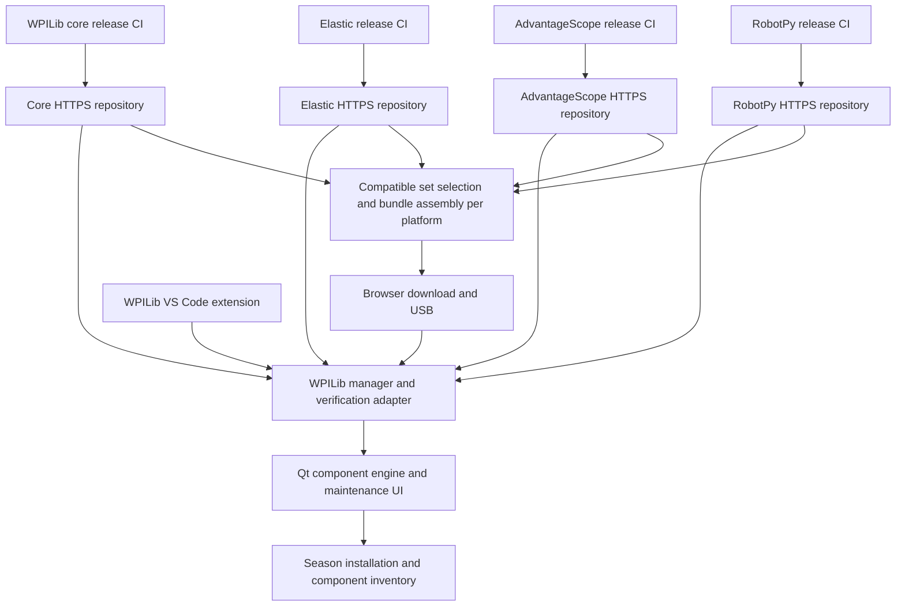

# WPILib package installer architecture proposal

Updated: November 27, 2026. Original installer repository baseline: `66733df`.

A runnable implementation is now in this repository; see [prototype status and remaining gates](prototype-status.md). This document describes the intended production architecture.

**Use Qt Installer Framework as the first implementation candidate, with independently published repositories for WPILib core, Elastic, AdvantageScope, and RobotPy, plus automated offline bundle assembly for each platform.** Validate it with a focused prototype before replacing the current installer. Keep the package definitions and publishing workflows independent of Qt so that extending the existing Avalonia application remains a practical fallback.

Qt Installer Framework is unusually close to this use case: a cross-platform SDK installer with selectable components, repositories, and a persistent maintenance tool. It can remove much of the work of implementing component installation, updates, and removal. WPILib would still own package boundaries, compatibility policy, trusted publication, offline bundle assembly, and VS Code integration. These responsibilities remain with WPILib under every evaluated option.

**The normal offline download should contain the latest compatible packages for one selected OS and architecture.** It should exclude other platforms and historical versions. A snapshot identifies the exact versions in that bundle; it does not mean downloading the entire hosted repository. Multi-platform downloads can be an advanced option.

Each project publishes its own repository index and package files. The installer combines their available components, while a separate automated job selects compatible repository revisions and assembles the browser-downloadable bundles. Online tool releases do not wait for a shared publication job or for offline bundle assembly.

The main decision gates are reliable offline upgrades, support for the existing architecture matrix, preservation of WPILib's installation layout, and verification of downloaded metadata before installer scripts execute. If meeting these requires a substantial Qt fork or replacing most of its lifecycle machinery, implement the same architecture in the current .NET codebase instead.

## Requirements and proposed behavior

| Requirement | Proposed behavior |
| --- | --- |
| Single-application UX | One user-facing application per platform, preferably one executable with GUI/CLI modes; at most one GUI plus one CLI shipped together. No separately acquired runtime/engine or manually launched helper. The installed maintenance entry point has the same requirement. |
| Fresh online installation | A small installer reads the approved repositories and downloads only selected packages and their dependencies. |
| Fresh offline installation | The installer reads a local bundle with the same package metadata and payloads used online. No network access is required. |
| Package upgrades in both modes | Compare installed package revisions with the combined online repository view or a local bundle, then update the chosen packages and required dependencies. |
| C++, Java, Python, and tools profiles | Profiles select sensible defaults. Advanced selection exposes individual packages and explains required dependencies. |
| Coarse downloadable packages | Distribute JDKs, standalone Python, toolchains, SDK/Maven collections, RobotPy wheel collections, editor support, and applications as packages. Maven coordinates and Python distributions remain internal SDK packaging details. |
| Browser-only offline preparation | Download the latest package set for a selected platform through ordinary browser links, copy it and the installer to USB, and install on another computer. |
| Independent upstream releases | Approved producer workflows validate and publish their own repositories. Compatible releases become visible without a shared index update, installer source edit, or executable rebuild. |
| Automated offline bundles | A separate job assembles the latest compatible packages from the approved repositories into one complete bundle per OS/architecture and season/channel. |
| VS Code update discovery | The WPILib extension invokes a stable manager command that reports updates as JSON and launches the installation's maintenance UI. |

“Latest” means the newest versions admitted to the selected season/channel that are compatible with each other and the target machine. Stable installations should not silently advance to prereleases, an incompatible tool major version, or another FRC season.

## Manager distribution and single-application UX

**Single-application delivery is a hard acceptance requirement.** Double-click must open a responsive GUI with source/bundle selection, progress and errors. Users must not operate a separate Qt installer or raw maintenance tool. Prefer one executable supporting GUI and headless commands; the allowed fallback is one GUI and one CLI sharing the same verification/planning implementation. A macOS app bundle counts as one application. Complete offline package bundles remain separate browser-downloadable data, not a requirement to embed every payload in the executable.

Bundle required runtimes/engine resources and install a persistent verified entry point so maintenance works after removing the original download or USB drive. Internal helpers may be embedded or private, but must not require separate acquisition, manual launch, or expose a third application. Define and test clean OS baselines, signing, self-update and GUI/CLI behavior. The present Python adapter plus separately supplied Qt engine does not yet meet this requirement.

The selected installed-client direction is **Rust plus a private Qt engine**. The [manager distribution evaluation](manager-distribution-evaluation.md) records the alternatives and native trust results. The [single-application prototype](rust-manager-prototype.md) has a Rust/egui window, embedded public bootstrap and native Qt worker, direct offline ZIP selection, and persistent GUI/CLI maintenance. Its four-runner workflow covers startup and offline lifecycle with fixtures and real dashboards. Online tough integration and the remaining production UX/distribution gates are still outstanding; Python remains the reference for online behavior and CI publishing.

## What the current repository already provides

The Gradle build has useful seams for this migration:

- [build.gradle](https://github.com/wpilibsuite/WPILibInstaller-Avalonia/blob/66733df2c2953821a29b43ee8e5b90db4331ac16/build.gradle) assembles `generateFullResources` from separate Gradle, toolchain, JDK, AdvantageScope, Elastic, and common-resource tasks. Today these become one platform artifact archive.
- [scripts/versions.gradle](https://github.com/wpilibsuite/WPILibInstaller-Avalonia/blob/66733df2c2953821a29b43ee8e5b90db4331ac16/scripts/versions.gradle) pins third-party releases centrally. [scripts/advantagescope.gradle](https://github.com/wpilibsuite/WPILibInstaller-Avalonia/blob/66733df2c2953821a29b43ee8e5b90db4331ac16/scripts/advantagescope.gradle) and [scripts/elastic.gradle](https://github.com/wpilibsuite/WPILibInstaller-Avalonia/blob/66733df2c2953821a29b43ee8e5b90db4331ac16/scripts/elastic.gradle) fetch upstream release archives. Those packaging recipes can become producer jobs instead of inputs to an installer release.
- [scripts/maven.gradle](https://github.com/wpilibsuite/WPILibInstaller-Avalonia/blob/66733df2c2953821a29b43ee8e5b90db4331ac16/scripts/maven.gradle), [gradleriobase/build.gradle](https://github.com/wpilibsuite/WPILibInstaller-Avalonia/blob/66733df2c2953821a29b43ee8e5b90db4331ac16/gradleriobase/build.gradle), and the offline dependency plugin already collect build dependencies. Reuse that work to produce complete SDK packages.
- [InstallSelectionModel](https://github.com/wpilibsuite/WPILibInstaller-Avalonia/blob/66733df2c2953821a29b43ee8e5b90db4331ac16/WPILibInstaller.Common/Models/InstallSelectionModel.cs) and [ArchiveExtractionService](https://github.com/wpilibsuite/WPILibInstaller-Avalonia/blob/66733df2c2953821a29b43ee8e5b90db4331ac16/WPILibInstaller.Common/Services/ArchiveExtractionService.cs) currently express selection primarily as everything versus JDK/tools, using filters over the archive. They do not provide an independently versioned package inventory.
- The GUI and CLI share services for extraction, Gradle preparation, tool configuration, VS Code setup, and shortcuts. These contain installation knowledge worth preserving even if Qt supplies the new UI and component engine.
- [CI](https://github.com/wpilibsuite/WPILibInstaller-Avalonia/blob/66733df2c2953821a29b43ee8e5b90db4331ac16/.github/workflows/ci.yml) already builds Windows, macOS, and Linux for both x64 and ARM64, and publishes installer outputs to Artifactory and Cloudflare object storage. The platform requirement therefore covers six existing build targets. Each package must declare which of those it supports.

There is also a material distribution constraint: [the VS Code page](https://github.com/wpilibsuite/WPILibInstaller-Avalonia/blob/66733df2c2953821a29b43ee8e5b90db4331ac16/WPILibInstaller.GUI/Views/VSCodePage.axaml) explicitly says VS Code is downloaded separately for licensing reasons. The current build packages extensions and editor metadata, while the installation flow obtains the editor separately. Preserve this distinction until redistribution permission changes. Microsoft's license distinguishes the branded product from its MIT-licensed source and restricts sharing the product. [VS Code license](https://code.visualstudio.com/license).

## Alternatives

The assessments below distinguish documented product capabilities from the engineering judgment about their fit for WPILib.

| Option | Free use and platform coverage | Fit for these requirements | Main tradeoff and disposition |
| --- | --- | --- | --- |
| **Qt Installer Framework** | Open-source licensing option; Windows, macOS, Linux. Validate the actual six builds and minimum OS versions. | Components, dependencies, remote and local repositories, maintenance UI, and CLI fit an SDK distribution well. | New Qt packaging/scripts and integration work, but substantial lifecycle reuse. **Preferred prototype.** [Overview](https://doc.qt.io/qtinstallerframework/ifw-overview.html). |
| **Existing Avalonia application with a package engine** | Existing BSD-3 code; current six-target build matrix. | Can implement the exact online/offline experience while preserving existing setup behavior. | WPILib must implement inventory, dependency planning, transactions, recovery, removal, and update contracts. **Fallback if Qt fails the prototype gates.** |
| **micromamba/conda packages with constructor** | micromamba and constructor have BSD-3 licenses. Constructor documents all six relevant targets. | Strong package/dependency machinery; constructor bundles resolved packages into installers; custom channels support controlled distribution. | Repackage everything into conda's environment model and build the WPILib selection/update UI. Shortcuts, signed app bundles, and existing paths still need integration. **Credible second engine, but more packaging change.** [micromamba](https://mamba.readthedocs.io/en/stable/user_guide/micromamba.html), [constructor](https://conda.github.io/constructor/), [platforms](https://conda.github.io/constructor/construct-yaml/#available-platforms), [licenses](https://raw.githubusercontent.com/mamba-org/mamba/main/LICENSE), [constructor license](https://raw.githubusercontent.com/conda/constructor/main/LICENSE.txt). |
| **InstallBuilder** | Proprietary; offers free licenses to qualifying open-source projects by application. | Selectable and downloadable components, cross-platform installer authoring, and update customization. | Attractive commercial tooling if a license is granted, but independent package publication and the common catalog still need design. Confirm CI/contributor rights and offline package maintenance before adoption. **Commercial shortlist.** [License program](https://installbuilder.com/open-source-licenses), [component documentation](https://releases.installbuilder.com/installbuilder/docs/installbuilder-userguide.html#_downloadable_components). |
| **install4j** | Proprietary; nonprofit open-source projects can apply for a license, with attribution requirements. Supports the three OS families. | Installation types, selectable/downloadable components, external media files, and updater actions are available. | Its distribution/update model needs adaptation for independently published packages; adds a Java-based installer toolchain. **Commercial shortlist if sponsorship is acceptable.** [License program](https://www.ej-technologies.com/install4j/openSource), [components](https://www.ej-technologies.com/resources/install4j/help/doc/concepts/fileGroups.html), [data files](https://www.ej-technologies.com/resources/install4j/help/doc/concepts/dataFiles.html). |
| **Velopack** | MIT-licensed application installer/updater with cross-platform support. | Useful for updating the package-manager application itself. | Its documented model centers on an application's releases. A selectable SDK package graph and offline dependency sets would remain WPILib work. **Supporting component, not the package architecture.** [Overview](https://docs.velopack.io/), [license](https://github.com/velopack/velopack/blob/develop/LICENSE). |
| **IzPack** | Apache-2.0; Java-based, cross-platform installers. | Customizable installation UI and native integration. | A Java bootstrap plus the independent package catalog and maintenance behavior would still need integration. **Less aligned than Qt for this project.** [Project documentation](https://izpack.org/). |
| **Native package managers and installer builders** | Different tools and packaging policies on each OS. | WinGet, Homebrew, and distribution packages can be additional delivery channels. WiX/NSIS and native platform installers can wrap individual platform payloads. | No common inventory, dependency policy, or browser-to-USB workflow across all targets; WPILib would maintain several backends. **Optional distribution adapters.** [WinGet](https://learn.microsoft.com/en-us/windows/package-manager/winget/), [Homebrew](https://docs.brew.sh/Installation). |

Conda is not restricted to Python payloads, so it should not be rejected on that basis. A viable conda design would use WPILib-owned packages and channels, with a bundled standalone engine and exact environment specifications. Its disadvantage here is adapting an existing SDK layout and desktop application collection to an environment manager while still maintaining a custom UI. Conda supports custom channels, including local channels. Avoid making Anaconda's default hosted repositories a dependency: their terms are separate from the package manager's license. [Custom channels](https://docs.conda.io/projects/conda/en/stable/user-guide/tasks/create-custom-channels.html), [repository terms distinction](https://docs.conda.io/projects/conda/en/stable/user-guide/install/).

“Free” in this recommendation means no required installer software license fee under the selected open-source terms. Hosting, bandwidth, platform signing, and engineering still have costs. The commercial products' free-license programs are possibilities, not grants WPILib can assume it already has.

## Why Qt is the first candidate

Qt Installer Framework provides component selection, install/update/remove workflows, and a maintenance tool that survives the initial installation. It supports arbitrary payloads; the installed applications do not have to use Qt. These are the central capabilities WPILib would otherwise need to build. [Getting started](https://doc.qt.io/qtinstallerframework/ifw-getting-started.html), [component update workflow](https://doc.qt.io/qtinstallerframework/ifw-use-cases-update.html).

The relevant integration points are concrete:

- `repogen` produces repository metadata and archives that can be served as static files. Updating changed components is supported. [Repository creation](https://doc.qt.io/qtinstallerframework/ifw-online-installers.html), [promoting updates](https://doc.qt.io/qtinstallerframework/ifw-updates.html).
- The installer can load multiple repositories. Core, Elastic, AdvantageScope, RobotPy, and future approved publishers can each own an index while contributing components to one installation. [Multiple repositories](https://doc.qt.io/qtinstallerframework/ifw-online-installers.html#configuring-repositories).
- Components declare dependencies and installation operations. Aliases can name collections of components; a WPILib profile page can select them and expose advanced choices. [Package format](https://doc.qt.io/qtinstallerframework/ifw-component-description.html), [aliases](https://doc.qt.io/qtinstallerframework/ifw-aliasconfig.html).
- The CLI supports `list`, `check-updates`, and updating specified components. `--set-temp-repository` accepts a list of URLs and can restrict a run to the local repositories in a bundle. These are useful foundations for VS Code and offline maintenance. [CLI workflows](https://doc.qt.io/qtinstallerframework/ifw-use-cases-cli.html), [CLI options](https://doc.qt.io/qtinstallerframework/ifw-cli.html).

Do not equate an offline installer executable with offline update support. Qt distinguishes offline-only and hybrid installers. The proposed USB workflow supplies a local repository set to the maintenance tool, and must be tested against an existing installation. Qt's `create-offline` command is useful for administrators, but it requires running an installer and therefore does not satisfy browser-only preparation by itself. [Offline installers](https://doc.qt.io/qtinstallerframework/ifw-offline-installers.html).

Qt IFW's source license is GPLv3 with the Qt Company exception. This is not a blanket LGPL assumption. Plan the notices, corresponding source/build materials, and obligations for the exact IFW and Qt binaries being distributed; preserve each payload's separate license. Resolve this as part of selecting the build configuration. [IFW license](https://github.com/qtproject/installer-framework/blob/master/LICENSE.GPL3-EXCEPT), [Qt licensing](https://doc.qt.io/qt-6/licensing.html).

The main limitations to prove are compatibility with WPILib's filesystem/setup operations, safe recovery, package version semantics, and authenticated repositories. IFW operations have DO and UNDO steps, but that does not establish crash-safe transactions for arbitrary subprocesses or external state. Every custom operation needs a defined recovery path. [Operations](https://doc.qt.io/qtinstallerframework/operations.html).

## Architecture



There are five independently versioned things:

1. **Manager:** the installer/maintenance application, including its verification adapter and platform helpers.
2. **Packages:** independently released installable units, such as Elastic or a C++ toolchain.
3. **Repository snapshots:** each publisher's immutable index, metadata, and package references for a season, channel, and target platform.
4. **Registry revisions:** independently authenticated publisher URLs, keys, component ownership, profile definitions, and selection policy.
5. **Offline bundle manifests:** the exact registry revision plus repository revisions, package versions, and hashes that form a validated complete platform set.

A new Elastic package changes only Elastic's repository. The manager discovers it without a new executable or edits to the core and AdvantageScope indexes. The bundle job subsequently incorporates it if compatible. Hosted storage retains older revisions for repair and reproducibility without sending historical payloads to normal users.

Use existing object storage/CDN infrastructure for delivery. Ordinary HTTPS-accessible files are sufficient; Qt IFW requires no database, package-server API, or directory listing. The publisher repositories may be separate prefixes on the same host, with publisher-specific write permissions. Repository generation runs in CI and bundle assembly runs separately; clients download static files. [Repository hosting](https://doc.qt.io/qtinstallerframework/ifw-online-installers.html).

| Repository | Publisher owns | Publication boundary |
| --- | --- | --- |
| WPILib core | SDK release groups, toolchains, shared runtimes/helpers, core tools, editor support, and documentation | Coordinate tightly coupled packages within this repository. |
| Elastic | Elastic application packages and their integration metadata | Publish independently on Elastic's release schedule. |
| AdvantageScope | AdvantageScope application packages and their integration metadata | Publish independently on AdvantageScope's release schedule. |
| RobotPy | Standalone host Python, RobotPy wheel collections, robot-target deployment archives, and Python integration metadata | Publish independently, coordinating Python ABI and RobotPy release compatibility within this repository. |

Partition repository views by season/channel and host platform. Maintain a trusted repository registry mapping each publisher to its URLs, keys, and allowed component IDs. Update that registry when onboarding or relocating a publisher; it does not need a change for every package release. The combined catalog is a client view of the enabled repositories, not another shared index that producers must publish. Publisher identities are configuration, not an enumeration in the installer. Each target registry supplies the approved URLs, keys, exact component ownership, optional repository precedence, and profile component lists. Adding a publisher is a reviewed registry change; its subsequent releases require no registry edit. Missing configured repositories remain errors rather than silently reducing the available package set.

Make a versioned WPILib manifest the producer contract. Generate IFW component metadata, repository indexes, and integration summaries from the same validated records, so dependencies and compatibility rules are not maintained twice. Prefer existing ZIP and tar.gz payload formats where they preserve the required permissions, links, and signatures; IFW supports both. This lets the .NET fallback reuse package bytes as well as publishing recipes. [Supported archive formats](https://doc.qt.io/qtinstallerframework/ifw-component-description.html).

Qt should own component installation records and the install/update/remove engine. A WPILib manager adapter should own installation discovery, repository verification, a stable CLI, and launching the correct engine. Export a read-only inventory summary for integrations after a successful operation; do not create a second mutable package database that can disagree with Qt.

## Authenticated registry updates

Ship a small trusted bootstrap with the manager: registry authority identity/key, stable HTTPS feed URL, season/channel/target scope, and an initial revision floor. The authority is separate from the component publishers and from the bundle signer. Package metadata cannot change the bootstrap key or authorize a publisher. The prototype now distributes this authority record as a TUF target using a pinned TUF root and maintained Python TUF client. The separate Ed25519 authority signer authorizes archival use under an explicit bootstrap policy, with indefinite offline installation as the default.

Before an online installation, update check, or bundle assembly, authenticate the latest registry catalog through the authority's TUF repository and validate its identity, scope, schema, revision, issuance, and online expiry. Online verification does not depend on the separate archival authority key or archival policy pinned in an old installer. The bundle assembler additionally verifies the archival envelope with the offline bootstrap it intends to support. A registry can add component IDs, publishers, URLs, and profiles without rebuilding the manager or Qt executable. Existing publishers continue publishing ordinary package releases independently; the registry authority acts only when approved configuration changes or its authorization needs renewal. New installer capabilities or unsupported metadata schemas can still require a manager update.

Keep the last accepted registry and its TUF verification evidence in a persistent per-user verified cache. The namespace binds the original TUF root and scope, independently of the archival key. On every read, reverify the original root chain, role signatures, metadata versions, and hashes binding the exact catalog. Atomically replace the record only after validating the candidate; reject lower registry revisions and changed content at the same revision. Serialize concurrent refreshes; a crashed process must not leave a permanent lock. Expired evidence establishes only a historical revision floor. Transport fallback requires a separate, current-clock TUF refresh against cached metadata. Invalid signatures, wrong identities/scopes, expired candidates, rollback, and malformed metadata never silently select older data. Migrate the earlier key-namespaced cache by authenticating its historical floor with its original archival pin.

An operation pins the registry it resolved before loading publisher snapshots. Record its identity, revision, and digest alongside the selected repositories and installation/update report. A registry changing during the operation does not alter that plan. Persisted rollback history assumes the cache and bootstrap have not been deleted or replaced by the local user; protect them as local application state. TUF root rotation and online continuity across archival-key changes are implemented. Emergency recovery and distribution of new offline archival pins remain administrative policies.

### Offline registry preservation

Every new offline bundle contains the exact registry snapshot used for assembly. For authenticated feeds this is the original authority-signed document, not a rewritten copy or a registry reconstructed from whatever repositories happen to be present. The signed bundle manifest binds the registry identity, revision, and SHA-256 as well as all publisher revisions. Include the registry identity in the bundle identifier and download metadata, so changing approval policy produces a distinct bundle even when package bytes are unchanged.

Offline installation starts from the already trusted bootstrap key, verifies the bundled registry, then verifies the bundle manifest using the bundle key authorized by that registry. Validate the registry-to-bundle binding and every publisher signature/hash before invoking Qt. Do not fetch the current feed or substitute the newest cached registry. An older three-publisher bundle remains valid after the online registry adds RobotPy because completeness is checked against the bundle's pinned three-publisher registry. Unexpected or missing publishers relative to that pinned registry remain errors.

Authorize archival registry use indefinitely, separately from online freshness. The trusted bootstrap and signed registry explicitly select `wpilib-archive-v2` with `lifetime: indefinite`; the signed offline expiry is `null`. Issuance time is audit information, not an offline validity check. An older offline revision may be used without lowering or replacing the online cache's revision floor. Keep the matching installer/bootstrap with the bundle so later changes to installed trust do not make retained media dependent on current infrastructure. Offline clients cannot learn later revocations; retaining that historical trust is the deliberate availability tradeoff. Earlier v1 bundles retain their bounded policy and require a one-time rebuild under v2.

The prototype retains manually trusted local-registry input for compatibility. New bundles made in that mode pin the exact local configuration by hash but have no authority-issued revision. Legacy bundles without a registry snapshot require their original matching local registry; they cannot obtain new trust by merely embedding public keys. Normal updated workflows use the authenticated source bootstrap and revisioned registry snapshots.

## Package boundaries and compatibility

Start with a few dozen coarse packages at most. Splitting every JAR or Maven coordinate would recreate a dependency ecosystem the installer does not need to manage.

| Package family | Contents | Version relationship |
| --- | --- | --- |
| Manager and integration helpers | Maintenance application, protocol adapter, shortcut/configuration helpers | Independent manager release; packages declare minimum supported manager version. |
| JDK | Host JDK and required notices | Independently packaged; compatible major version constrained by SDK/build tools. |
| Host Python | Private standalone CPython with pip, virtual-environment support, native runtime prerequisites, and notices | Python ABI/OS/architecture compatibility constrained by RobotPy packages. |
| RobotPy development | Pinned host wheels for RobotPy, simulation, and their transitive dependencies | A tested collection tied to the supported Python ABI and season. |
| RobotPy deployment support | Robot-target Python runtime and wheel collections for supported robot targets | Robot-target identity and Python ABI are separate from host-platform identity. |
| Gradle runtime and build support | Distribution, wrapper support, required plugin/dependency closure | Coordinated with the SDK where necessary. |
| WPILib SDK common | Shared build dependencies, metadata, common vendordeps | Member of a tested WPILib release group. |
| Java SDK | Java libraries, relevant native runtime dependencies, optional sources/docs | Same tested SDK release group. |
| C++ SDK | Headers, libraries, host/robot-target dependencies | Same tested SDK release group. |
| C++ toolchains | Cross-compilers and associated sysroots/runtime files | Separate host and robot-target identity; constrained by SDK. |
| WPILib tools | Initially a cohesive tools bundle; split tools only where independent updating is useful | Core tools can follow the SDK group. |
| Elastic | Application, launcher integration, required runtime files | Independent upstream version and compatibility declaration. |
| AdvantageScope | Application, launcher integration, required runtime files | Independent upstream version and compatibility declaration. |
| Editor support | WPILib VSIX plus C++ and Java extension groups | WPILib VSIX compatibility with SDK; extension/runtime requirements recorded. |
| Documentation | Offline user docs and language API documentation | Optional package with explicit content version. |
| VS Code editor | External acquisition recipe and locally supplied archive | Separate redistribution policy; see offline workflow below. |

The initial SDK may need to stay larger than the ideal Java/C++ split. The acceptance criterion is that a clean machine can build the supported examples offline. Split further only after identifying shared Maven coordinates, Gradle plugins, native libraries, and their ownership. Deduplicating payloads at the expense of a reliable offline closure is a poor first-release tradeoff.

Profiles should be convenient defaults, with dependencies enforced:

| Profile | Defaults |
| --- | --- |
| C++ development | SDK common, C++ SDK/toolchains, JDK, Gradle, WPILib tools, C++ editor support, and editor acquisition when requested. |
| Java development | SDK common, Java SDK, JDK, Gradle, WPILib tools, Java editor support, and editor acquisition when requested. |
| Python development | Standalone host Python, RobotPy development and deployment packages, Python editor support, and optional dashboards. |
| Tools only | Selected dashboards and WPILib tools, plus only the runtimes those tools require. |
| Advanced | Individual compatible components, with dependency explanations and download/installed sizes. |

C++ development still needs Java to run Gradle. Tools-only must not acquire a compiler or editor unless a selected package actually requires it. Users can combine language profiles; Python alone does not acquire Java or C++ toolchains unless a selected component declares that dependency. Profile changes add/remove requested capabilities; they must not unexpectedly remove independently selected packages.

Package metadata needs a stable ID, upstream display version, monotonically increasing package revision, host OS/architecture, minimum OS/runtime requirements, season compatibility, dependency/conflict information, release-group identity, installed-file ownership, compressed and installed sizes, archive hashes, license materials, source provenance, release notes, and minimum manager version. A packaging fix can increase the package revision without inventing a new upstream application version.

Use an IFW-compatible numeric version derived from the package revision, while displaying the original upstream version separately. IFW documents a numeric version syntax, so upstream tags such as `v27.0.0-alpha-6` need an explicit mapping. Keep prerelease and stable channels separate. [Version and dependency syntax](https://doc.qt.io/qtinstallerframework/ifw-component-description.html).

Each repository offers one revision of each component ID per target/channel. Qt resolves dependencies by ID/version across the loaded component collection and obtains each component's archives from its associated repository. A tool can therefore depend on a helper in the core repository. Dependencies do not discover repository URLs: the manager must enable every required repository. Missing or incompatible dependencies must block the affected installation plan. [Dependency resolution](https://github.com/qtproject/installer-framework/blob/4.11.0/src/libs/installer/installercalculator.cpp#L192), [global component lookup](https://github.com/qtproject/installer-framework/blob/4.11.0/src/libs/installer/packagemanagercore.cpp#L2271).

Give each component ID exactly one publishing owner, and enforce that mapping during validation. Keep shared runtimes/helpers in the core repository rather than publishing competing copies in tool repositories. Prefer self-contained dashboard packages with minimal cross-repository dependencies, so tools-only installations remain small.

There is no atomic release across independently published repositories. Keep SDK packages that must change together in the core repository and require tool releases to preserve declared season compatibility. A breaking cross-repository change needs staged publication or an explicitly coordinated release set. The manager checks each online plan against installed versions and declared dependencies; the offline job additionally validates the complete selected combination. Qt's dependency checks do not establish that a combination was tested, and should not be treated as a general historical-version solver.

Core SDK packages with ABI/build compatibility requirements update as a release group. An independent dashboard update should leave the installed SDK unchanged unless a declared dependency requires a coordinated change. Show such changes before installation. If a user pins part of a release group, withhold the conflicting group update and explain why. Do not change robot project dependency versions merely because the SDK installation changed; older project-pinned artifacts must remain available or be supplied by an explicitly selected SDK compatibility package.

Keep seasons in separate installation roots initially. Install Elastic and AdvantageScope within the applicable season to avoid introducing shared ownership across years. Cross-season deduplication of installed applications can be revisited later; caching download blobs by hash is already safe and useful.

### RobotPy and Python environments

RobotPy fits the same coarse package model. Publish standalone Python and complete, tested wheel collections through the RobotPy repository. Keep individual PyPI distributions inside those collections rather than exposing every wheel as an IFW component. Add a Python development profile and expose optional vendor collections through advanced selection.

The host Python distribution must support development, pip, and virtual environments and run without an existing system Python. Select a redistributable standalone build and validate relocation, native-library dependencies, certificates, executable permissions, and platform signing. Keep this runtime privately owned by the season installation. Do not modify system Python or adopt user-installed distributions into installer ownership.

Resolve and pin the full wheel dependency set in CI, including hashes, for each supported Python ABI, host OS, and architecture. Install from the verified local wheel collection with package indexes disabled; never fall back to downloading a missing dependency or compiling an sdist on a disconnected user machine. pip supports installation from local distributions with `--no-index` and `--find-links`. The offline bundle promises the supported RobotPy/vendor baseline, not every package a team may request from PyPI. [Local package installation](https://pip.pypa.io/en/stable/user_guide/#installing-from-local-packages).

Host development packages and robot deployment artifacts are separate capabilities. Include the relevant robot-target Python and wheels in a host-platform bundle, and integrate them with RobotPy's supported download/cache and deployment paths. RobotPy already distinguishes host package installation from fetching the runtime and packages needed on the robot. Preparing this data must not require connecting to a robot during desktop installation. [RobotPy installation and synchronization](https://docs.wpilib.org/en/latest/docs/zero-to-robot/step-2/python-setup.html).

Constrain Python ABI and native library compatibility explicitly. Treat a Python minor-version transition and its dependent wheel collection as a coordinated change; retain the old runtime while supported project environments still reference it. Stage and validate a replacement managed environment before activating it. Keep team project environments and pinned requirements outside replaceable managed payloads, and avoid an uncontrolled `pip install --upgrade` mutating files owned by IFW. An environment-creation operation must record ownership and support repair/removal. VS Code should discover the appropriate managed/project interpreter without rewriting project requirements.

Python and wheel availability may cover fewer targets than the installer itself. Declare support per package and target; do not assume a standalone interpreter makes every native RobotPy dependency available. A target's complete bundle includes its supported Python profile only when that runtime, host wheels, and robot artifacts form a validated set. Unsupported profiles must be explicit in the download page and installer.

## Online installation and maintenance

The manager selects a target installation, season, channel, and profile, refreshes and pins the authenticated registry, verifies the approved repositories, pins their revisions for that operation, and asks the engine for the package changes. The UI shows versions, dependency-driven changes, download size, disk requirements, and release notes before applying them. Only missing selected payloads are downloaded; existing valid cached archives are reused. A repository changing during the operation must not change an already reviewed plan.

If a repository is unavailable or fails verification, report that state rather than treating its packages as removed or up to date. Do not apply changes whose dependency validation requires the missing repository. The prototype should establish whether unrelated updates can proceed using a complete previously verified view; otherwise require retry or an offline bundle.

Use resumable downloads to disk and verify hashes before extraction. Peak-space checks must include the download cache, staged extraction, and retained recovery data. Configure proxies at the manager layer, with actionable errors for school networks and interrupted downloads. Never silently switch to a different channel or partial installation when a download fails.

Serialize operations per installation. Check running applications and builds before replacing packages they use. Prefer per-user installation; explicitly supported shared installations need separate machine-wide state/locking and narrowly scoped elevation. Preserve the existing discovery paths and compatibility links during migration, rather than changing installation location and package management simultaneously.

Package ownership must be explicit. Packages can share directories, but two packages must not independently overwrite or remove the same file. Shared Maven metadata should be generated by an owned integration operation; Maven artifacts needed by supported older projects must not disappear during a routine update. Preserve user settings, logs, workspaces, and application data outside replaceable package payloads. Disable or coordinate application self-updaters for managed copies to prevent inventory drift.

Qt's built-in operations should handle ordinary file changes. Wrap Gradle cache setup, VSIX installation, shortcuts, and other external effects in idempotent operations with recorded prior state. On cancellation or failure, restore the previous usable state or enter an explicit repair state. Recovery must include operation logs and retained known-good payloads; ordinary upgrades should not promise arbitrary version downgrades. Retain the previous working repository revisions and installation plan for recovery, and provide a deliberate restore/reinstall path. Proving recovery after power loss is a release gate, not an assumed property of Qt.

The manager itself has a separate update path. Publish a compatible signed manager alongside every offline bundle, with both versions recorded on the download page; a convenience wrapper may include it. Ship the manager under the single-application requirement above, including all required engine/runtime resources; a clean offline machine must not acquire Python, .NET, Java, Go, Rust, or Qt separately to run it. Ordinary maintenance and VS Code entry points must open the same verified manager; any raw engine/updater helper stays private. When a package requires a newer manager, update/restart the manager first, then re-evaluate the package plan. Do not replace a running manager executable in place without a platform-appropriate handoff.

## Browser downloads and offline installation

The download page should lead with **Latest packages for your platform**, with explicit OS and architecture selectors. Browser detection can suggest a choice, but must allow selecting the USB destination computer's platform. Show the season/channel, build date, included versions, total size, and a link to older bundles separately.

The initial download choices should be:

- The small installer/manager for that platform.
- One **complete current package set for that platform**, covering all supported profiles, with one selected revision per package and the dependency closure.
- A clearly identified separate VS Code download when the user wants the Microsoft editor.

Use ordinary, prebuilt download files, such as a ZIP/ZIP64 containing the ready-to-use local repository set. Do not require a downloader program, command line, account, hundreds of browser downloads, or assembling a multi-gigabyte ZIP in browser memory. The browser may run on a different OS from the destination machine.

The complete platform bundle should include only that platform's payloads plus required platform-independent data. Historical packages remain in hosted storage, and other OS/architecture variants remain separate downloads. A macOS universal upstream archive can be reused where appropriate; this does not require including both complete platform sets. Different robot-target toolchains are capabilities within a host platform, not extra host OS downloads.

Generate these bundles with the automated assembly job described below. Each bundle has an immutable identifier and signed manifest recording the the pinned registry identity/revision/hash and selected revisions of all configured repositories, every included package/hash, and any external acquisitions. Changing Elastic need not rebuild allwpilib, the JDK, or the manager. It does require regenerating affected complete bundle containers. Keep online repository releases and the latest successfully assembled offline bundle separately identified so a failed bundle job does not produce a broken download link or conceal a working online update.

Initially preserve the separate repositories inside one download. This keeps publisher metadata and component identities intact and avoids introducing a merged index solely for offline use. Include only the current package payloads referenced by the selected compatible revisions; exclude obsolete files that happen to remain on the hosting server. Retain the required publisher metadata and trust material with each repository.

Illustrative layout after extracting a Windows x64 bundle:

```text
WPILib-2027-stable-win-x64-000042/
  bundle-manifest.json
  registry.json  (authority-signed registry snapshot)
  trust/
  repos/
    core/
      Updates.xml
      component metadata and selected current package archives
    elastic/
      Updates.xml
      component metadata and selected current package archives
    advantagescope/
      Updates.xml
      component metadata and selected current package archives
    robotpy/
      Updates.xml
      host Python, wheel collections, and robot-target archives
  licenses/
  external/
    README.txt
```

The installer can auto-discover this directory beside itself or let the user choose it. The manager resolves the manifest's relative repository paths to local URIs and restricts the operation to that complete local set. On an empty machine it installs selected packages. On an existing installation it opens maintenance for that installation and offers newer compatible packages from the bundle. Preserve component IDs across online and offline sources so this remains an update to the same installed packages. Missing packages/dependencies produce a preflight error before modification; an older bundle does not automatically downgrade newer installed packages. **Offline mode must prohibit network requests**, including repository redirects, manager updates, VSIX dependencies, JDK acquisition, and package setup hooks.

For the Qt prototype, demonstrate the existing maintenance tool updating a named component using `--set-temp-repository` with a comma-separated list of the configured `file:///` repository URIs, including a dependency supplied by another repository. Use a maintenance-capable online/hybrid build restricted to those local sources, rather than assuming an offline-only build's generated maintenance tool can update. Production entry points go through the verification adapter described below. [Local repository options](https://doc.qt.io/qtinstallerframework/ifw-cli.html), [offline maintenance distinction](https://doc.qt.io/qtinstallerframework/ifw-use-cases-cli.html).

A combined offline repository remains an alternative: `repogen` accepts repeated `--repository` arguments to repack downloaded local repositories into one output. That requires the selected payloads locally and additional metadata generation. Preserve separate repositories for the initial implementation unless the prototype identifies a concrete advantage to combining them. [Repository repackaging](https://doc.qt.io/qtinstallerframework/ifw-tools.html#repogen).

Later, add smaller prebuilt Java, C++, or tools bundles if download measurements justify them. An optional export command can create an update bundle containing only changes from a known installed inventory, including dependencies. Such an incremental bundle must record its baseline and must not be presented as suitable for a fresh installation. Multi-platform media is an advanced composition of the individual platform sets.

Large bundles may exceed FAT32's file-size limit. Display the size and recommend suitable USB formatting, or support independently verifiable volumes below that limit that the manager reads/reassembles locally. Avoid requiring an external archive utility on the destination machine. This is a packaging choice to measure against actual bundle sizes.

### VS Code acquisition

The browser page should link directly to the exact Microsoft-hosted editor archive required by the selected bundle. Record its expected filename, platform, size, and SHA-256 in the trusted bundle manifest. The user places that archive beside the bundle, and the installer imports it locally. For online installation, the same recipe downloads directly from Microsoft.

This meets browser-only preparation without presuming WPILib can redistribute the branded editor. It means the default developer preparation flow has an additional browser download, which should be stated clearly. If a single hosted download including VS Code is mandatory, obtaining redistribution permission is a dependency. Replacing it with a Code OSS build would require separate validation of extensions, Marketplace access, and support expectations, so it is not a drop-in assumption. [Product/source license distinction](https://code.visualstudio.com/license).

The bundle manifest must distinguish included packages, external acquisitions, and unsupported/missing components so “complete” is truthful. The offline installer should reject a missing required editor archive or allow an explicit install-without-editor choice. Hash mismatches must fail verification. Audit each extension's redistribution and offline dependency requirements as well; those are independent of the editor's license.

## Automated upstream publication

Provide reusable package-building and validation workflows that each producer invokes in its own release CI. Each project owns its repository publication, including its index, snapshots, and payloads. There is no global `Updates.xml` or shared online publication job. A release carries stable package IDs, revisions, source commit/tag, target matrix, dependency/compatibility metadata, license materials, and immutable payload digests.

The normal producer path is fully automated:

1. The upstream release workflow builds its normal release artifacts and invokes the WPILib packaging workflow. For allwpilib, this can trigger an aggregator that collects the complete SDK/build dependency closure after the upstream artifacts are available.
2. Candidate archives and metadata enter that publisher's staging prefix. Its credentials permit writes only to its assigned repository, and validation rejects component IDs or file ownership outside its allowed scope.
3. Automated checks verify provenance, dependencies, platform signatures, fresh installation, and update behavior against supported core versions. Compatibility declarations are checked against allowed seasons and release groups.
4. The producer generates its repository snapshot and uploads the new payloads and metadata. It makes the updated index/channel pointer visible only after all referenced files are available. Retain immutable snapshots and referenced objects so an installation or bundle job can finish against a captured revision. Core release groups wait for their required members/targets; tools can advance independently on supported targets.
5. Serialize index updates within that publisher's repository or use compare-and-swap retries. Elastic and AdvantageScope update different indexes, so their release jobs do not need to serialize against each other.
6. Installers discover the published release on the next check. A release event requests offline bundle assembly; periodic reconciliation catches missed events. Online availability does not depend on the bundle job succeeding.

Initial publisher onboarding and changes to compatibility policy require maintainer decisions. Routine releases within that established policy need no manual installer edit, catalog PR, or approval. A new major version with no admitted compatibility declaration remains a visible candidate/rejected publication with an actionable CI result; it is not silently promoted as a safe upgrade.

If an upstream project cannot modify its CI immediately, run a WPILib-owned release watcher/adapter against that project's published releases. It performs the same packaging and validation automatically. Prefer direct producer integration for the steady state.

The initial implementation uses separate GitHub Actions signing and storage secrets for each publisher and for the registry authority. Scope storage credentials to that publisher's prefix where the provider supports it; use separate buckets when credentials only offer bucket-level isolation. A future deployment can exchange GitHub Actions OIDC identity for short-lived storage credentials or use a signing service that retains private keys outside runners. That service need not serialize or assemble publisher releases. [GitHub OIDC](https://docs.github.com/en/actions/concepts/security/openid-connect), [R2 token scopes](https://developers.cloudflare.com/r2/api/tokens/).

Keep release objects immutable. Removing an unsafe release means publishing newer repository metadata that marks it withdrawn and offers a replacement; it does not mean mutating bytes behind an existing hash. Exclude withdrawn releases from ordinary selection and new bundles while retaining the records needed to diagnose installed copies.

### Repository generation in a release job

`repogen --update` modifies a local repository directory; it does not update the HTTPS host directly. For a repository with several components, CI can download its existing index and required metadata, then supply only the components being released:

```text
repogen --update -p changed-packages repo-work
```

For Qt IFW 4.11.0, the existing `Updates.xml` preserves unchanged entries. If that index contains `MetadataName`, the referenced combined metadata archive must also be present locally. Old application, SDK, or toolchain payload archives are not required for this metadata merge. A repository consistently generated with only `--component-metadata` can retain unchanged entries using its index alone; changing that option on an existing repository does not remove the requirement to supply an already referenced combined archive. Pin the IFW version and verify this partial-workspace behavior in CI. [Index merging](https://github.com/qtproject/installer-framework/blob/4.11.0/src/libs/ifwtools/repositorygen.cpp#L178), [existing metadata handling](https://github.com/qtproject/installer-framework/blob/4.11.0/src/libs/ifwtools/repositorygen.cpp#L1110).

Upload generated files additively, with the index published last. Do not use a mirror operation that deletes remote files absent from this partial workspace. A tool repository containing just one component can instead generate a complete new repository revision from that release alone. Neither method requires downloading the other publishers' repositories. [Publication ordering](https://doc.qt.io/qtinstallerframework/ifw-updates.html#uploading-partial-updates).

An immutable snapshot can capture the index and metadata while retaining the original repository base URL for unchanged versioned payloads. The verification adapter preserves that mapping. If instead publishing each snapshot as a complete new directory, make all referenced payload paths available there through server-side copying or equivalent storage reuse; a partial CI workspace alone is not a complete standalone repository.

## Automated offline bundle assembly

Run a WPILib-owned assembly workflow for each supported OS/architecture and season/channel. Trigger it after a producer publishes, with scheduled reconciliation as a fallback. Use a cache keyed by payload hash so rebuilding a bundle after an Elastic update reuses unchanged SDK and AdvantageScope archives. The job gathers already built release artifacts; it does not rebuild the applications.

For each target, the job should:

1. Refresh and verify the registry, pin its signed identity/revision/hash, then read and verify its approved repositories and capture their exact snapshot revisions and hashes, and resolve the complete package set for all supported profiles, including shared dependencies and external acquisition recipes.
2. Select the newest compatible repository revisions under the declared dependency and release-group rules. Evaluate the current heads together, including any coordinated dependency upgrades. Use the last successful set as a fallback and advance compatible revisions independently where possible; retain a previous compatible revision when a newer one cannot be admitted. Record any held-back release and its reason. Preserve archived repository revisions so this choice is reproducible.
3. Fetch the selected metadata and all included package payloads, verifying hashes and signatures. Unlike a producer's incremental index update, complete bundle assembly needs the full selected platform set locally; its cache avoids repeated downloads. Include no historical package payloads or other host platforms.
4. Validate cross-repository dependencies, ownership, and offline completeness. Run the relevant fresh-install and upgrade checks with networking blocked, including external VS Code import using the pinned acquisition recipe.
5. Package all selected local repositories, trust material, licenses, and signed bundle manifest into one browser-downloadable file. The manifest binds the embedded registry snapshot and records publisher/repository identities, source revisions, component versions, payload hashes, target platform, minimum manager version, and external acquisitions. Map repository paths locally and reject uncontrolled redirects to remote repositories.
6. Upload the tested immutable bundle, signed download details, and its permanent HTML page, verify origin contents and anonymous public availability, then replace that target's live `index.html` as the single commit point. Serialize publication and reject a candidate if the live upgrade baseline changed during native testing. Events arriving during assembly must trigger another reconciliation against current repository heads.

If validation fails, dependencies are unavailable, or a complete compatible set cannot be produced, keep the last successful bundle available and report the failure to maintainers. Display its actual build date and included versions, including any compatibility holdback; do not silently ship an incomplete bundle or claim it contains every newest upstream release. A new online release remains independently available subject to the installer's compatibility checks.

The prototype implements this flow in [the offline download workflow](../.github/workflows/offline-bundles.yml), with one storage configuration per platform/season/channel under `deployment/bundle-publications/`. It supports R2/S3 uploads and Artifactory staging/promotion independently of publisher hosting. It requires a fresh authenticated registry, verifies the resulting ZIP member-by-member, and signs a download record binding the ZIP hash/length, pinned registry, publisher revisions, versions, and holdbacks. The page displays these identities and whether offline authorization expires; richer release-date presentation remains future UI work.

Publication now has three phases: prepare a signed candidate and fetch the last successful ZIP; validate those exact bytes on the target's native runner; publish only after validation succeeds. Every publication also requires the Windows, macOS, and Linux fixture lifecycle gates, which exercise an actual component version upgrade even for first publication. Candidate tests install every component and each registry profile from independent empty caches, install the preceding bundle, upgrade through its maintenance tool, add newly offered components, verify inventory and installed payload hashes against a fresh candidate installation, and confirm older media cannot downgrade the result. Linux uses a network namespace, macOS a network-denying sandbox, and Windows scoped outbound firewall rules for Python and Qt. Windows rules do not sandbox arbitrary package child tools; those require additional isolation when real setup recipes are introduced.

The native report binds the signed candidate-plan digest, candidate ZIP hash, baseline ZIP hash, target, and suite version. Only successful reports from the same trusted workflow run are consumed. These reports are CI evidence, not independent cryptographic attestations. The publish job re-verifies candidate contents and current authorization, reacquires the destination lock, and rejects a changed live-head hash. It never reassembles after testing. Artifactory promotion and R2 uploads remain behind these gates; failed checks leave all public files untouched. The artifact handoff temporarily retains both ZIPs, requiring adequate runner disk and Actions storage. Native publication currently covers Windows/Linux x64 and macOS x64/ARM64; Windows/Linux ARM64 fails closed pending pinned native Qt tooling and runners. Real payload build/simulation checks and external VS Code import remain future acceptance extensions.

Immutable objects live under `bundles/<zip-sha256>/`: the ZIP, `bundle.json`, and an HTML permalink. The root `index.html` embeds the verified selection and links to those files and the previous successful bundle. It is static HTML requiring no JavaScript. There is no separately mutable public `latest.json`, avoiding disagreement between page and pointer after a partial publication. Local assembly still emits its existing draft metadata.

R2/S3 retains conditional creation and a conditional final page write; large archives now use multipart uploads with the immutable condition on completion. Artifactory stages and verifies the exact set, promotes it, checks it again, then updates the page under its designated writer's destination lock. Anonymous URL checks verify ZIP length and exact metadata/HTML bytes, including inline HTML rendering. The [download deployment guide](../deployment/offline-bundles.md) covers configuration and host requirements.

Failures before the final page write preserve the previous selection. Old ZIPs and permanent pages are never deleted. Unchanged selections are verified without reuploading; retries reuse identical immutable bytes. Registry and common publisher revisions cannot regress. A lost final-write acknowledgement is recovered by reading back the intended page; an unavailable read-back leaves an indeterminate outcome instead of triggering an unsafe rollback. Either complete page remains backed by retained immutable objects. Live credentials, hosting configuration, and deployment acceptance remain operational setup.

## Trust and repository verification

TLS and an archive checksum from the same untrusted repository do not establish publisher authenticity. Authenticate each repository's index, component metadata/scripts, and payloads before IFW consumes them. Platform code signing complements this check but does not cover every archive or metadata file.

### Signing roles and CI process

Use separate TUF online role keys for each repository, plus distinct Ed25519 keys for the three archival roles below. Online root/targets/snapshot/timestamp responsibilities are implemented with python-tuf; root keys stay offline. These keys do not require purchased certificates. Platform signing and notarization remain separate release steps with their own credentials.

| Signing role | Signed content | CI owner and secret |
| --- | --- | --- |
| Registry authority | Publisher public keys, repository URLs, exact component ownership, profiles, bundle public key, scope, increasing registry revision, online expiry, and explicit archival policy | WPILib authority workflow; `REGISTRY_SIGNING_KEY` |
| Publisher | One immutable publisher revision: component identities/versions/dependencies, file ownership, SHA-256 and length of every IFW index, metadata file, and payload | Each publisher's release workflow; its own `PUBLISHER_SIGNING_KEY` |
| Bundle assembler | Exact selected publisher revisions and payloads, plus the identity/revision/hash of the embedded authority-signed registry | WPILib offline assembly workflow; `BUNDLE_SIGNING_KEY` |

Generate keys once through a trusted administrative process, retain recovery copies securely, and commit only public keys. Install the authority public key through the trusted installer bootstrap. Publishers and the assembler never receive the authority private key. The authority admits publisher/bundle public keys through reviewed configuration changes. Routine releases and registry lifetime renewal then run unattended.

The reusable [publisher release workflow](../.github/workflows/publisher-release.yml) runs after the producer has built, tested, and completed platform signing/notarization. Its same-run input artifact contains `release.tar`, preserving executable modes, with the package specification and finalized payload directories. It checks the live authority-signed registry, generates IFW archives, hashes the final bytes, signs the publisher manifest, and verifies the signature against the authorized publisher key before uploading anything. There must be no subsequent modification of signed application bundles or hashed package files.

Each release job verifies its origin TUF metadata and catalog of signed release manifests, but downloads no previous payload archives. This implementation builds a complete snapshot of that publisher's current components, so multi-component publishers supply all of their current payloads. The sparse `repogen --update` optimization described above remains separate future integration work. Elastic and AdvantageScope have independent configurations, keys, indexes, buckets/prefixes, and release jobs; RobotPy and other publishers use the same workflow without source changes.

Publication supports two configurable backends. Existing configurations default to S3-compatible storage, including Cloudflare R2. That backend retains conditional immutable creation and ETag compare-and-swap for `tuf/metadata/timestamp.json`. Artifactory uses Generic Local staging/release repositories, server-side promotion, and a serialized writer for each publisher destination. Both read authenticated origin metadata, retain immutable revisions, and advance the TUF timestamp only after the complete revision and metadata are available. Installers and the offline assembler follow the registry's HTTPS URLs and can combine publishers hosted on either backend. [S3 conditional PutObject](https://docs.aws.amazon.com/boto3/latest/reference/services/s3/client/put_object.html), [R2 conditional operations](https://developers.cloudflare.com/r2/api/s3/api/).

For Artifactory, provision a private Generic Local staging repository and a publicly readable Generic Local release repository for each publisher. For example, Elastic uses `elastic-installer-staging-local` and `elastic-installer-release-local`. All target/season/channel paths can share that publisher's pair. The signed registry points only at the release repository. The authority may use its own pair or remain on R2. Generic repositories accommodate the IFW archives and signed metadata without imposing another package manager's indexing rules. [Artifactory repository types](https://docs.jfrog.com/artifactory/docs/repository-management-overview).

The implemented Artifactory publication sequence is:

1. Acquire the destination's GitHub Actions concurrency group, then verify the live TUF metadata and catalog. Generate and sign the new revision using the existing publisher pipeline.
2. Upload that revision's files to staging with SHA-256 checksum headers. Verify the complete staged file set using Artifactory's stored checksums and lengths; reject any conflicting existing immutable file.
3. Promote exactly those files into the release repository using Artifactory's server-side Copy Item API, preserving their relative paths and bytes. This is explicit path-based promotion; the prototype does not create JFrog build-info records, invoke build-status promotion, or require Release Lifecycle Management. It copies no other revision or publisher, downloads no old archives, and never includes the mutable TUF timestamp in the promotion set. [Deploy Artifact](https://docs.jfrog.com/artifactory/reference/deployArtifact), [Copy Item](https://docs.jfrog.com/artifactory/reference/copyitem).
4. Verify every promoted file's SHA-256 and length. Partial or failed promotion leaves the previous index untouched; unreferenced files can be retained for diagnosis or recovery.
5. Generate the new catalog and TUF targets/snapshot/timestamp metadata. Stage, promote, and verify their immutable paths, then re-read the live TUF timestamp within the same serialized job. Reject a changed head; otherwise publish `tuf/metadata/timestamp.json` last and verify it.

Serialization is a deployment requirement for the Artifactory backend, rather than an assumption that its PUT or promotion APIs provide S3-style compare-and-swap. The concurrency key is derived from the canonical API origin, release repository, and prefix; configuration filename, workflow name, branch, staging repository, and public URL aliases do not change it. Each prefix identifies a publisher/platform/season/channel. Distinct publishers and platforms therefore proceed independently. Registry publication uses the same mechanism for its independent TUF destination.

GitHub concurrency groups apply within a repository, so configure one authoritative `writer_repository` and keep that destination's deployment token exclusively in its protected environment. All workflows writing that destination must use the same group. The CLI requires the configured Actions repository and matching serialization identity before Artifactory publication; these guards do not create a cross-repository distributed lock. Multiple repositories needing to publish the same destination must route through its designated writer. Normal Elastic and AdvantageScope release jobs remain independent. Jobs use `queue: max` and do not cancel the running publication; the revision check still rejects a late older release. [GitHub concurrency scope and queueing](https://docs.github.com/en/actions/how-tos/write-workflows/choose-when-workflows-run/control-workflow-concurrency).

The Artifactory backend adds two repositories and a promotion/verification pass per publisher, providing isolated staging and server-side transfer. R2 retains a simpler direct immutable upload with storage-enforced conditional writes. Neither backend needs a shared publication job across publishers, and neither assumes multi-file atomic visibility. A timeout during the final head write can have an indeterminate outcome; inspect the head before retrying. Any successfully published new head references an already verified complete revision. Configure public caches to revalidate mutable heads and keep old immutable files available.

The [registry renewal workflow](../.github/workflows/registry-renewal.yml) discovers platform publication configurations and checks daily. By default, it renews when online authorization has at most three days remaining, issuing a new revision valid for seven days online with explicit indefinite archival authorization. It verifies the current origin envelope and reuses that exact approved configuration; it does not silently apply an old checkout's publisher list. A manually selected `apply` run signs a reviewed configuration change. First publication additionally requires explicit initialization. Revision allocation follows the authenticated origin head, including when that head has expired, and skips abandoned immutable revisions without overwriting them, including signed revisions left only in Artifactory staging. Artifactory promotes the immutable registry record and TUF metadata before replacing the live timestamp; R2 retains its conditional-write path. Access errors never become an empty registry or reset its revision.

Renewal does not rebuild application payloads or change existing bundles. Each existing offline bundle retains its original registry revision and archival policy; new bundles use the newly verified revision. Indefinite offline installation requires no renewal. The offline publication schedule discovers renewals and publisher releases without publisher credentials or an authority key, then publishes verified complete downloads through its own storage credentials.

Use protected Actions environments and trusted release refs, with signing credentials available only to the publication step. Pull-request jobs do not sign. The implementation writes the PEM secret to a temporary mode-0600 file, removes it from the child-process environment, and cleans it up on exit. Runners executing a signing job remain trusted: a compromised authorized workflow can use its key. Protect workflow/configuration changes and pin the reusable workflow and its tooling checkout to the same reviewed commit. Human review is for onboarding and policy changes; normal releases and scheduled renewal need no per-run approval. [GitHub reusable workflows and secrets](https://docs.github.com/en/actions/how-tos/reuse-automations/reuse-workflows).

Monitor renewal success and remaining online validity. GitHub can disable scheduled workflows in inactive public repositories, so a cron declaration alone is not an availability guarantee. If online authorization expires, online clients fail closed until a higher signed revision is available; do not extend validity locally. Retained v2 offline bundles remain installable. [Scheduled workflow inactivity](https://docs.github.com/en/actions/how-tos/manage-workflow-runs/disable-and-enable-workflows).

The [CI deployment guide](../deployment/ci-signing.md) gives key setup, secret names, storage mappings, upstream workflow integration, and failure recovery. TUF online roles, client verification, authenticated root updates, and online continuity across archival-key rotation are implemented. Emergency recovery, distribution of replacement offline trust pins, withdrawal administration, and hardened signing services remain deployment work. [TUF setup and archival policy](../deployment/tuf.md) defines the current trust boundaries and workflows.

### Production trust implementation

The working reference prototype uses `python-tuf==7.0.1` with separate root, targets, snapshot, and timestamp roles for the registry authority and every publisher. The maintained `ngclient.Updater` performs current-clock expiry, threshold signatures, rollback protection, hash checks, and sequential root rotation. Roots are pinned in reviewed bootstrap/registry configuration; per-repository caches are locked and retain trusted metadata history. Metadata-only registry transport failures may use a reverified unexpired cache. Signature, expiry, rollback, and integrity failures do not downgrade to the custom protocol. HTTPS bootstraps and CI require TUF; legacy local/loopback fixtures remain only for regression coverage. [Python TUF client](https://theupdateframework.readthedocs.io/en/stable/api/tuf.ngclient.html).

The selected production installed-client language is Rust, as recorded in the [single-application evaluation](manager-distribution-evaluation.md). The [Rust single-application prototype](rust-manager-prototype.md#native-online-updates) now integrates tough for authenticated registry/publisher refresh, verified current-clock caches, bounded resumable root catch-up, and offline-to-online upgrades. It interoperates with Python-generated repositories; CI signing and publication remain Python tooling. Discovery fetches catalogs and signed Qt indexes; selected payloads are verified into private local repositories before the Qt worker runs. Durable checkpoints retain verified rollback floors even when a later refresh stage fails; historical root rotations are not replayed as new rotations that clear those floors.

Each repository's logical TUF target is a catalog: the authority's catalog contains its signed archival registry record; a publisher's contains up to eight full signed release manifests. Their hashes bind the Qt indexes, metadata archives, and payloads. Payload verification and compatibility selection remain adapter responsibilities. The publisher catalog is authenticated by that publisher's own TUF metadata, so no shared snapshot/timestamp publication job is introduced. Core, Elastic, AdvantageScope, and RobotPy can release or renew independently.

CI publishes immutable payloads, a hash-prefixed catalog, versioned targets/snapshot metadata, and an immutable timestamp audit copy before replacing the live timestamp as the sole online commit point. Publisher renewal uses the same destination lock and resigns the unchanged catalog without old payload downloads. Daily renewal refreshes all online roles: timestamp defaults to two days, snapshot seven, targets thirty, capped by root expiry. Authority renewal also maintains the seven-day online registry record and its explicit indefinite archival authorization. Root setup creates a two-of-three offline root threshold; rotation tooling verifies old and new signatures. Routine CI has only its scoped online/archival keys. Origin state and authorized publishing workflows remain trusted infrastructure; TUF does not neutralize an attacker who can make the authorized publisher sign malicious metadata.

The [TUF deployment guide](../deployment/tuf.md) supplies key setup, source/registry fields, secret names, independent scheduled publisher callers, staged online-key rotation, migration, and recovery limits. Ordinary root updates do not require changing installer executables or bootstrap files. Replacing `REGISTRY_SIGNING_KEY` causes CI to publish a higher TUF-authenticated registry revision even before scheduled renewal is due. Online clients accept it through TUF without changing their archival pin. New offline media requires a matching independently trusted bootstrap; an online registry cannot rewrite old media's trust.

Returning clients can traverse root histories longer than 256 rotations, including expired starting/intermediate roots. Each operation runs up to four batches of 256 remote root requests. Every batch uses the standard python-tuf Updater with the original bootstrap and revalidates the complete cached chain; cached filenames only size the traversal allowance. Each transition still needs the exact next version and both root thresholds. Timestamp and target access is blocked until the available root chain has been traversed, and normal final-root/metadata expiry is mandatory. Exhausting the work budget saves verified progress and returns a retryable `root-update-pending` status. Retrying with the same cache continues without a cumulative history limit; a work limit never authorizes a partial catalog or stale fallback. The publication-origin verifier likewise supports the full chain. Preserve all numbered roots and long-lived endpoints.

Repository separation and component naming do not enforce publisher isolation by themselves. The adapter must reject a repository defining another publisher's component IDs, and installation validation must reject conflicting file ownership. Shared runtimes have a single authorized owner. Each publisher's scripts still execute with installer capabilities, so scripts and shared operations remain part of that publisher's trust boundary.

Do not assume stock IFW provides TUF verification. The prototype should prove a verification adapter that exposes only verified repositories to IFW. One concrete approach is a loopback repository gateway with one path per publisher: it authenticates metadata before serving it, retrieves requested archives on demand, and serves each only after hash/length verification. It accepts only paths from the pinned repository revisions, binds locally with a per-run token, and uses a verified cache. For offline operation it verifies the bundle manifest and included publisher metadata, maps the repositories to local sources, and never fetches missing files.

Disable direct remote repository configuration in the supported WPILib workflow. Every maintenance entry point, including VS Code and shortcuts, must use the adapter. If IFW cannot enforce this integration and handle lazy archive access without a large fork, that is a reason to choose the .NET fallback. A verification wrapper that runs only on first install would leave the subsequent update path unprotected.

Offline media uses the implemented `wpilib-archive-v2` policy with an explicitly indefinite lifetime. The trusted bootstrap pins a separate archival authority key and the exact policy. An authority-signed registry record identifies publisher archival keys, bundle key, namespaces, issuance time, and `offline_expires_at: null`; its online expiry remains finite. A schema-3 bundle binds that exact record, selected releases and payloads, policy, issuance time, explicit `expires_at: null`, and TUF catalog provenance. Assembly requires fresh TUF verification of the authority and every publisher; native acceptance gates then test the exact ZIP.

Offline verification checks authority/bundle/publisher signatures, every file hash and length, namespaces, ownership, dependencies, and the explicit archival policy. Unknown or mismatched policies, missing authorization, and tampering fail closed. The v2 path performs no wall-clock check, TUF fetch, or online-cache mutation. New metadata-only TUF renewals keep catalog hashes unchanged and do not force a new ZIP; new authority authorization or selected releases do change bundle identity. No periodic re-signing or online activation of a retained v2 bundle is needed.

A valid old archive remains usable indefinitely even after online metadata expires or a later registry withdraws a publisher. Keep its trusted installer/bootstrap with the ZIP. Disconnected users cannot learn current revocations or detect a backdated forgery after archival-key compromise; non-expiring authorization accepts that limitation. Offline installations can subsequently use the same TUF client for online upgrades, preserving current-clock verification, cached online history, and installed package version floors. The archival signature is an explicit additional trust contract and does not claim current online freshness. Existing bounded v1 bundles keep their original expiry; regenerate them once with v2 authorization and a matching bootstrap as described in the [migration guide](../deployment/tuf.md#earlier-bounded-bundles).

Preserve signed macOS app bundles during repackaging and staple notarization tickets where applicable. The Elastic/AdvantageScope [release recipes](../packaging/README.md) now preserve framework symlinks and file modes. AdvantageScope’s Electron resources also carry signature bytes in extended attributes. The prototype retains these from the upstream archive, restores them unchanged through a generated native `xattr` operation after Qt extraction, and checks their hashes plus `codesign --verify --deep --strict` during offline acceptance. This avoids re-signing the upstream application; disconnected Gatekeeper/quarantine and notarization-ticket behavior still require separate validation. Sign the manager and helpers for their platforms. Validate Windows locked-file behavior, macOS quarantine/notarization while disconnected, and Linux executable modes, library baselines, and application integration. Archive extraction must reject path traversal, escaping links, and file collisions. Package scripts should use reviewed shared operations rather than acquiring arbitrary new behavior from unverified metadata.

## VS Code integration

Add a small, versioned protocol to the WPILib manager. The following commands are proposed interfaces, not commands implemented in the current repository:

```text
wpilib-manager installations --json
wpilib-manager check-updates --installation <id> --json
wpilib-manager open --installation <id> --view updates
wpilib-manager open --installation <id> --source <bundle-directory>
```

The JSON response should identify protocol version, installation, channel, registry identity/revision/digest and refresh/cache status, each repository's identity/revision/status, any bundle revision, installed and offered package revisions, display versions, compatibility blockers, release notes, and whether a manager update is required. Distinguish “no updates” from “offline,” “repository verification failed,” and “unsupported manager protocol.” An unavailable tool repository must not be reported as having no updates. Normalize engine output inside the adapter; do not make the extension parse localized Qt console messages or internal component files.

The extension checks on activation and periodically with caching/backoff, and offers a command to check immediately. It checks installed packages for the selected season, honors disabled checks and pins, and shows a nonblocking notification with **Review updates**, **Later**, and a way to suppress the reminder. Clicking Review launches the manager by its registered absolute path with an argument array, allowing the installer to show the actual change plan. Discovery does not install updates automatically.

Store manager location and installation IDs in a documented per-user discovery file, plus a machine-level registration for supported shared installs. Do not obtain executable paths or arbitrary repositories from an untrusted robot project. After maintenance completes, the extension refreshes inventory and requests reload/restart only when needed. Updating the editor itself may require closing VS Code; the detached manager must continue running after that happens.

Remote SSH, containers, WSL, and browser-based VS Code need explicit handling: the package manager should run on the machine whose installation is being managed. Put local discovery/launch behavior in a local UI extension component and communicate with workspace-side logic where necessary; disable unsupported browser launches with instructions. VS Code documents multiple extension-host locations and placement controls. [Extension hosts](https://code.visualstudio.com/api/advanced-topics/extension-host).

## Migration and validation

Introduce the publication format before retiring the existing distribution. The old monolithic installer can temporarily be assembled from the same newly produced packages, avoiding two independent sets of packaging recipes.

| Stage | Deliverable and exit condition |
| --- | --- |
| Single-application distribution | Close UX-1–UX-9 and G1–G8 in the [distribution evaluation](manager-distribution-evaluation.md), including actual GUI startup, installed maintenance after media removal, headless CLI, signed artifacts, clean-machine dependencies and recoverable self-update. A library smoke test or existing engine-only CI does not satisfy this gate. |
| Package inventory | Map existing archives and setup actions into packages with exclusive file ownership, redistribution policy, dependencies, and a complete offline build closure. |
| Qt feasibility prototype | Load separate core, Elastic, AdvantageScope, and RobotPy repositories from configuration. Add a synthetic publisher without changing installer code. Install representative components, resolve a cross-repository dependency, update one tool online and from USB, and remove/reinstall it. Exercise all six build targets and the minimum OS baselines. Prove the verification adapter and inventory/update contract. |
| Independent repository publication | Real tool releases publish their own repository revisions without an installer edit or shared index writer. Verify concurrent publishers and incremental `repogen` jobs using only old metadata plus new component data. |
| Offline bundle assembly | Producer releases automatically trigger a complete compatible bundle for each affected platform. Preserve separate local repositories, record exact inputs, validate disconnected installation/upgrades, and advance download links only after success. |
| Usable installer | Profiles, advanced selection, local-media discovery, external VS Code import, recovery, and signing all work. Installer tests run with networking blocked. |
| Migration and VS Code | Detect old installations, migrate safely, register manager discovery, and add update notifications/launch commands. |
| Default switch | Make the new installer the default only after installation, upgrade, recovery, and browser/USB acceptance scenarios pass. Retain a supported legacy path during the transition. |

Existing installations lack the new per-package ownership records. Do not infer safe ownership from filenames and immediately allow selective removal. Prefer a controlled migration: detect the legacy installation, preserve settings and needed project artifacts, install a known package set into a managed staging/root location, validate it, then switch launchers/discovery. If preserving the exact root requires replacing content there, keep a rollback copy and block running processes. Unknown or modified files must not be silently adopted and later deleted as package-owned files.

Acceptance should include:

- Fresh Java, C++, Python, combined, and tools-only installs on each supported host target. Build and simulate representative projects with an empty user cache and networking blocked; include required robot-target artifacts and vendordeps. Define the supported offline project set explicitly rather than claiming all possible third-party dependencies are included.
- A browser on one OS downloading a different destination platform's latest bundle; copying it, the manager, and the required external editor archive to USB; then installing on a clean disconnected destination.
- Updating Elastic alone from its own repository without downloading or modifying the SDK or republishing another repository; updating a coordinated SDK release group; adding Java support to an existing C++ install; removing a tool without harming other packages.
- An existing offline installation updated from a newer bundle, an older bundle offered to a newer install, missing/corrupt payloads, and incompatible/pinned components. Detect problems before changing installed files.
- Interrupted download, disk exhaustion, cancellation, process termination during installation, locked Windows executables, and failed configuration hooks. Demonstrate recovery to a usable installation or a reliable repair path.
- Cross-repository dependencies online and offline, incompatible versions, missing repository metadata, and duplicate component IDs. Verify publisher namespace and file-ownership enforcement.
- Concurrent releases in separate repositories and overlapping releases in one repository; incremental generation without old payloads; stale CDN metadata, package tampering, withdrawn releases, per-repository key rotation, indefinite offline authorization decades after issuance, and expiry enforcement for earlier bounded media.
- Registry addition of a publisher/profile without changing the client executable or bootstrap; valid cached fallback during transport failure; rejected tampering, wrong authority/scope, expiry, rollback, same-revision changes, and concurrent refreshes; using old offline media after a newer registry is cached without lowering online history.
- Bundle assembly while a publisher advances its repository; exact snapshot reproduction; compatibility holdbacks; missed-event reconciliation; and an older or failed job leaving the latest successful download link intact.
- Python installation with no system Python or user pip cache; local simulation/import tests; robot deployment cache completeness; blocked network access; incompatible Python ABI and absent native wheels; preservation of project environments during a coordinated Python/RobotPy update.
- Manager self-update and VS Code discovery/launch from both local and remote workspaces; preservation of project files and user settings during migration.

Use clean VMs/native runners for these scenarios. A successful installer build alone does not demonstrate offline completeness or upgrade correctness. OS support should be an explicit baseline, including Linux system libraries; unsupported prerequisite combinations must be detected before installation rather than trying an online system package install during an offline run.

## Tradeoffs and decision rule

The hosted repositories, compatibility checks, producer onboarding, complete dependency packaging, browser bundles, and VS Code protocol are necessary work whichever engine is chosen. Qt reduces client lifecycle work; it does not eliminate distribution engineering.

Separate repositories remove the shared online index writer and let tools release on their own schedules. The costs are more metadata fetches, additional trust identities and availability states, and no atomic release across publishers. Keep tightly coupled core packages together and constrain tool compatibility accordingly. Offline assembly provides a reproducible tested combination without becoming a prerequisite for online publication.

The largest ongoing costs will be cross-platform installation tests, packaging upstream changes, hosting repeated complete platform bundles, and support for old installations. Immutable package storage and reusing identical archives reduce repeated work. Initially omit binary delta patches: independent package downloads already avoid redownloading the whole SDK, while deltas add another format and recovery path. Add them only if measured bandwidth justifies them.

Prebuilt platform bundles trade extra storage/assembly for a dependable browser experience. A custom bundle-generation service could reduce stored combinations, but adds request handling, caching, failure modes, and operating cost. Start with the complete current set per target; add profile bundles based on observed demand.

Keep the Qt prototype bounded to the feasibility gates above. Choose it if it delivers reliable component maintenance with modest scripts/helpers and an enforceable trust boundary. Choose the existing .NET application if retaining the required layout, authenticated downloads, and failure recovery would otherwise mean maintaining a substantial Qt fork. In that fallback, keep the repository contracts, independent publishing workflows, and offline assembly job, replace the Qt engine with a shared GUI/CLI package service, and explicitly budget for ownership records, deterministic dependency planning, staged/journaled installation, repair, and removal.

For the .NET fallback, put those behaviors in a shared package service rather than in view models. Resolve the combined view of pinned repository revisions into an immutable change plan, verify and stage all required archives, journal the intended changes, apply owned-file/configuration operations, and commit the inventory only after success. With one offered revision per package, dependency planning can start with a constrained graph instead of a general multi-version solver. Use versioned installation directories where existing launchers allow them, and journaled replacement with backups where fixed paths must remain. Reuse the existing configuration helpers after making their effects recoverable; the current extraction-into-place loop is not sufficient for package transactions.

The initial architecture decision can therefore be made now: **publish core, Elastic, AdvantageScope, and RobotPy through separate authenticated repositories configured in an extensible registry, and automatically assemble their latest compatible packages into one complete offline bundle per platform.** The prototype decides which engine should own installation and maintenance.

## Self-contained installed application

The manager and private Qt engine must work without separately installed language runtimes, Qt libraries, VC redistributables, or FUSE. The [runtime distribution policy](self-contained-runtime.md) specifies the OS baseline, Linux host graphics and an isolated private Qt library environment, Windows static CRT, macOS framework audit, and native/clean-OS acceptance. The GUI loads the OS graphics stack without a private library search path. On X11 desktops missing the keyboard bridge, it loads only a matched three-library keyboard fallback; it never loads the Qt worker's general dependency directory. The installed maintenance copy retains the same runtime. AppImage is optional packaging, not a runtime-dependency solution by itself.
