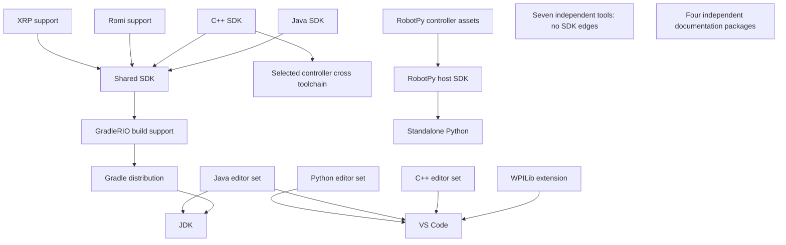

# Package catalog — review draft

**Status: proposed, awaiting review. No registry, package recipe, client, or publication configuration is changed by this draft.** This defines the intended catalog, not a claim that the payloads, compatibility ranges, or publisher integrations already exist. The [machine-readable companion](package-catalog-draft.json) is review data, deliberately not a deployable registry or publisher specification.

The proposal has **29 component IDs across 9 publishers**, with 28 applicable to a single controller generation, and 9 profiles. The starting scope is the current WPILib distribution plus RobotPy: complete development environments, tools, documentation, and optional training-platform support. It does not enumerate every Maven artifact, wheel, shared library or VSIX as an installer component. Those belong in each recipe's locked dependency closure.

## Decisions to review first

| Decision | Proposed default | Tradeoff / review point |
| --- | --- | --- |
| SDK granularity | Shared SDK data, Java SDK and C++ SDK; separate GradleRIO, Gradle and JDK | Enables language selection without turning Maven into an installer package registry. Exact shared-coordinate ownership still needs release inventory. |
| Editor granularity | VS Code, WPILib extension, and C++/Java/Python extension sets | Supports command-line-only installations and different editor release schedules. A language extension set is a tested group, not every VSIX separately. |
| Tools | Seven individually selectable desktop applications, with private app runtime dependencies | Tools-only does not automatically install a JDK, SDK, editor or compiler. Verify actual upstream linkage before claiming that independence for every tool/version. |
| Default language profiles | Selected language, editor support, all seven tools, user guide and that language's API docs | Familiar complete setup; advanced selection can omit tools/docs/editor. Review whether both dashboards should be defaults or one should be optional. |
| RobotPy | Standalone Python, one host SDK/tool closure, and one controller deployment asset closure | Avoids exposing pip-level choices and duplicate ownership in a managed environment. Arbitrary project/vendor extras remain outside the baseline. |
| Controller generations | Distinct roboRIO and Systemcore toolchain IDs; materialize one approved controller context per season/feed | Prevents silently reusing an incompatible compiler/sysroot. Supporting both within one installation would need an additional explicit design. |
| Documentation | Four independent optional components | Can be read without installing SDKs; full offline platform bundles still contain them. |
| Publishers | Producer-aligned feeds plus one distribution-maintenance feed for curated third-party runtimes/editor assets | Independent publication; more feeds increase renewal and compatibility-search work. Review the nine-feed topology before provisioning. |

Review package boundaries, profile defaults, publisher ownership and controller/season policy before implementing the importers or producer actions. Concrete versions, sizes and artifact locks follow the approved boundaries; they are intentionally not guessed here.

## Scope and evidence

The inspected legacy source is [`WPILibInstaller-Avalonia` at `66733df`](https://github.com/PeterJohnson/WPILibInstaller-Avalonia/tree/66733df2c2953821a29b43ee8e5b90db4331ac16). Its `scripts/versions.gradle` and `gradleriobase/build.gradle` describe a 2027 alpha/Systemcore setup. It is a source inventory reference, **not the last released installer baseline**. The first import must choose and lock the actual release and audit differences. No 2026 roboRIO artifact is presumed compatible with 2027 Systemcore.

Relevant source inventory includes [`scripts/maven.gradle`](https://github.com/PeterJohnson/WPILibInstaller-Avalonia/blob/66733df2c2953821a29b43ee8e5b90db4331ac16/scripts/maven.gradle), [`scripts/vscode.gradle`](https://github.com/PeterJohnson/WPILibInstaller-Avalonia/blob/66733df2c2953821a29b43ee8e5b90db4331ac16/scripts/vscode.gradle), `scripts/{jdk,toolchain,gradlew,tools,vars}.gradle`, `gradleriobase/build.gradle`, and the archive/tool/editor/shortcut services. This identifies the five native WPILib tools, two independent dashboards, build closure, editor extensions and setup operations; final release locks remain authoritative for exact contents.

The official [installation guide](https://docs.wpilib.org/en/latest/docs/zero-to-robot/step-2/wpilib-setup.html) corroborates the current seven-tool selection and separates native desktop simulation prerequisites from the robot cross toolchain. The draft deliberately changes the legacy tools-only JDK default to explicit runtime dependencies. The [WPILib extension manifest](https://raw.githubusercontent.com/wpilibsuite/vscode-wpilib/main/vscode-wpilib/package.json) declares a VS Code engine requirement; recipe locks must inspect the actual selected VSIX and all extension dependencies. These moving references were consulted on 2026-11-27, not pinned as release inputs.

RobotPy's [deployment implementation notes](https://robotpy.readthedocs.io/en/latest/dev/deploy.html) distinguish host commands from controller runtime and wheel caches. This motivates separate host and controller asset components. Their exact release-specific wheel lists, controller support and cache integration still need validation.

## Dependency notation and platform policy

Every dependency in the tables is a **direct required component**, unless marked for a controller context. Profiles select root components and automatically include their transitive dependencies. A profile is not an installed package. Documentation and applications appearing together in a profile do not acquire hard dependencies on one another.

- `same-sdk-release` / `same-robotpy-release`: release-cohort equality or an explicitly approved compatibility relation, including partial upgrades against already-installed versions.
- `tested-sdk-build-pair`: an approved SDK/GradleRIO combination, not arbitrary newer GradleRIO.
- `tested-controller-abi`: compatible controller OS/architecture, compiler/runtime ABI and SDK release.
- `python-abi`: the supported CPython ABI/platform and runtime range, not simply “Python newer than X.”
- `tested-compatible`: a reviewed consumer/runtime or editor engine range; exact bounds come from locked artifacts and native tests.

**These are intended constraints, not current wire syntax.** Today's client and publisher format express numeric minimum versions only. The production catalog cannot safely encode these requirements by pretending every newer dependency is compatible. Before deployment, review either explicit ranges/cohort support in the format and planner, or coarser packages that keep inseparable content together. Merely publishing all components in one repository snapshot does not make a partial installed upgrade atomic or ABI-safe.

Intended host targets are Windows x64, Linux x64, macOS x64 and macOS ARM64. Every package needs a validated host/controller availability matrix before entering a real registry. Windows/Linux ARM are future targets, not implied by legacy download URLs. Platform-independent material can have identical payloads across host feeds. The default browser bundle contains the complete latest-compatible catalog for one host, season and controller context, not all hosts or old releases; install profiles select a subset from it.

Paths below are proposed ownership boundaries relative to the installation root, not a finalized seasonal layout. `maven/<...>/` denotes disjoint explicit coordinate/file sets, never ownership of the entire shared directory. Existing real dashboard IDs and `tools/elastic` / `tools/advantagescope` paths are retained. New layouts require compatibility adapters where existing tools expect legacy locations.

## Component catalog

### Build and SDK

| Package ID / name | Contents and proposed ownership | Direct dependencies | Publisher / development input |
| --- | --- | --- | --- |
| `org.wpilib.jdk` Java JDK | Full pinned JDK, including compiler and runtime; used by Java and Gradle-based C++ builds. **Paths:** `jdk/ (versioned physical backing recommended)` | None | `distribution` Legacy JDK payload or locked vendor archive |
| `org.wpilib.gradle` Gradle distribution | Pinned Gradle distribution plus wrapper bootstrap archive/cache seed; not project build outputs or user caches. **Paths:** `gradle/distributions/; managed wrapper seed` | `org.wpilib.jdk` (tested-compatible) | `distribution` Legacy Gradle ZIP or locked upstream distribution |
| `org.wpilib.build` GradleRIO build support | GradleRIO, plugin markers, build/deploy plugins and transitive Maven/POM closure; owns coordinates also used by SDK packages when shared. **Paths:** `maven/<explicit build-support coordinates>/; build-support/` | `org.wpilib.gradle` (tested-compatible) | `gradlerio` Legacy build closure or locked GradleRIO/Maven artifacts |
| `org.wpilib.sdk.common` Shared WPILib SDK data | Shared SDK Maven coordinates, native/JNI and simulation dependencies used by both languages, common vendor descriptors and season data; excludes build-owned coordinates and tool executables. **Paths:** `maven/<explicit common coordinates>/; vendordeps/<core descriptors>/; sdk/common/` | `org.wpilib.build` (tested-sdk-build-pair) | `core` Legacy Maven/resources or locked allwpilib/Maven closure |
| `org.wpilib.java` WPILib Java SDK | Java API artifacts, annotation processing, test dependencies, language-specific examples/template inputs and sources/Javadocs used by the IDE; full selected-host/controller closure, including controller JVM deployment assets if required by the selected release deployment model. **Paths:** `maven/<explicit Java-only coordinates>/; sdk/java/` | `org.wpilib.sdk.common` (same-sdk-release) | `core` Legacy payload or allwpilib/Maven Java outputs |
| `org.wpilib.cpp` WPILib C++ SDK | C++ headers/libraries, sources, native test dependencies, example/template inputs, host simulation and controller build variants. **Paths:** `maven/<explicit C++-only coordinates>/; sdk/cpp/` | `org.wpilib.sdk.common` (same-sdk-release) `org.wpilib.toolchain.roborio` (tested-controller-abi — roborio only) `org.wpilib.toolchain.systemcore` (tested-controller-abi — systemcore only) | `core` Legacy payload or allwpilib/Maven C++ outputs |
| `org.wpilib.toolchain.roborio` roboRIO cross toolchain | Host-executed compiler, linker, debugger and sysroot for the selected roboRIO release; not a desktop compiler. **Paths:** `toolchains/roborio/ (legacy layout compatibility mapping required)` | None | `toolchains` Pinned legacy toolchain or matching upstream release |
| `org.wpilib.toolchain.systemcore` Systemcore cross toolchain | Host-executed compiler, linker, debugger and sysroot for the selected Systemcore release; not a desktop compiler. **Paths:** `toolchains/systemcore/ (legacy layout compatibility mapping required)` | None | `toolchains` Pinned legacy toolchain or matching opensdk release |

### Optional training support

| Package ID / name | Contents and proposed ownership | Direct dependencies | Publisher / development input |
| --- | --- | --- | --- |
| `org.wpilib.support.romi` Romi support | Bundled Romi Java/C++ artifacts and vendor descriptor, with required host simulation pieces. Data for either selected language, not another full SDK. **Paths:** `maven/<Romi coordinates>/; vendordeps/Romi*` | `org.wpilib.sdk.common` (same-sdk-release) | `core` Legacy artifacts or matching allwpilib/Maven outputs |
| `org.wpilib.support.xrp` XRP support | Bundled XRP Java/C++ artifacts and vendor descriptor, with required simulation client. Python bindings are a separate RobotPy closure decision. **Paths:** `maven/<XRP coordinates>/; vendordeps/XRP*` | `org.wpilib.sdk.common` (same-sdk-release) | `core` Legacy artifacts or matching allwpilib/Maven outputs |

### Editor

| Package ID / name | Contents and proposed ownership | Direct dependencies | Publisher / development input |
| --- | --- | --- | --- |
| `org.wpilib.vscode` Managed VS Code | Dedicated portable editor and bundled editor runtime; no dependency on Java/C++/Python SDKs. **Paths:** `vscode/; dedicated writable editor user-data location excluded from payload ownership` | None | `distribution` Legacy separate editor download or locked official portable archive |
| `org.wpilib.vscode.wpilib` WPILib VS Code extension | WPILib VSIX and its embedded templates/examples/resources; future update discovery and language-aware integration. **Paths:** `extensions/wpilibsuite.vscode-wpilib/; vsCodeExtensions/<WPILib VSIX>` | `org.wpilib.vscode` (tested-compatible) | `vscode-wpilib` Pinned release VSIX or signed/tested producer output |
| `org.wpilib.vscode.cpp` C++ editor support | Pinned C/C++ extension and its offline language/debugger dependencies. **Paths:** `extensions/<C++ extension IDs>/; vsCodeExtensions/<C++ VSIXs>` | `org.wpilib.vscode` (tested-compatible) | `distribution` Locked legacy VSIX or upstream VSIX closure |
| `org.wpilib.vscode.java` Java editor support | Pinned Java language, debugger and dependency-view extensions with complete offline dependencies. **Paths:** `extensions/<Java extension IDs>/; vsCodeExtensions/<Java VSIXs>` | `org.wpilib.vscode` (tested-compatible) `org.wpilib.jdk` (tested-compatible) | `distribution` Locked legacy VSIX set or upstream closure |
| `org.wpilib.vscode.python` Python editor support | Pinned Python editing/debugging extension closure. Exact extension set and offline language-server redistribution need review. **Paths:** `extensions/<Python extension IDs>/; vsCodeExtensions/<Python VSIXs>` | `org.wpilib.vscode` (tested-compatible) | `distribution` Locked upstream VSIX closure; new recipe |

### Desktop tools

| Package ID / name | Contents and proposed ownership | Direct dependencies | Publisher / development input |
| --- | --- | --- | --- |
| `org.wpilib.glass` Glass | Glass executable and private native/runtime resources; Windows app-local runtime libraries where required. No Gradle or SDK needed to launch. **Paths:** `tools/glass/; per-tool launch descriptor` | None | `core` Legacy tools/artifacts or matching allwpilib/Maven native release |
| `org.wpilib.outlineviewer` OutlineViewer | OutlineViewer executable and private native/runtime resources; Windows app-local runtime libraries where required. No Gradle or SDK needed to launch. **Paths:** `tools/outlineviewer/; per-tool launch descriptor` | None | `core` Legacy tools/artifacts or matching allwpilib/Maven native release |
| `org.wpilib.sysid` SysId | SysId executable and private native/runtime resources; Windows app-local runtime libraries where required. No Gradle or SDK needed to launch. **Paths:** `tools/sysid/; per-tool launch descriptor` | None | `core` Legacy tools/artifacts or matching allwpilib/Maven native release |
| `org.wpilib.datalogtool` Data Log Tool | Data Log Tool executable and private native/runtime resources; Windows app-local runtime libraries where required. No Gradle or SDK needed to launch. **Paths:** `tools/datalogtool/; per-tool launch descriptor` | None | `core` Legacy tools/artifacts or matching allwpilib/Maven native release |
| `org.wpilib.wpical` WPIcal | WPIcal executable and private native/runtime resources; Windows app-local runtime libraries where required. No Gradle or SDK needed to launch. **Paths:** `tools/wpical/; per-tool launch descriptor` | None | `core` Legacy tools/artifacts or matching allwpilib/Maven native release |
| `org.wpilib.elastic` Elastic | Complete official WPILib application distribution and its bundled runtime, resources and licenses. **Paths:** `tools/elastic/; licenses/elastic/` | None | `elastic` Existing pinned upstream adapter, then producer release output |
| `org.wpilib.advantagescope` AdvantageScope | Complete official WPILib application distribution and its bundled runtime, resources and licenses. **Paths:** `tools/advantagescope/; licenses/advantagescope/` | None | `advantagescope` Existing pinned upstream adapter, then producer release output |

### RobotPy

| Package ID / name | Contents and proposed ownership | Direct dependencies | Publisher / development input |
| --- | --- | --- | --- |
| `org.robotpy.python` Standalone Python | Supported relocatable CPython, standard library, packaging/bootstrap tools and required private native libraries. No system Python dependency. **Paths:** `robotpy/python/ (ABI/version-specific backing)` | None | `robotpy` Locked standalone Python distribution or RobotPy-provided runtime |
| `org.robotpy.sdk` RobotPy host SDK and tools | One coherent host wheel closure: WPILib bindings, commands, CLI/deployer, tests/pyfrc, simulation and required native dependencies; locked baseline wheelhouse and managed seed environment. No arbitrary project extras. **Paths:** `robotpy/host-wheels/; robotpy/sdk/; generated project venvs excluded` | `org.robotpy.python` (python-abi) | `robotpy` Pinned RobotPy host wheels or producer outputs |
| `org.robotpy.deploy` RobotPy controller deployment assets | Offline target Python/runtime archive and controller wheel closure, matched to the host SDK. Host deploy command lives in SDK; this component supplies robot-side assets. **Paths:** `robotpy/target/<controller>/; pip_cache/pkg_cache compatibility mapping` | `org.robotpy.sdk` (same-robotpy-release) | `robotpy` Pinned target runtime and wheels or RobotPy producer outputs |

### Documentation

| Package ID / name | Contents and proposed ownership | Direct dependencies | Publisher / development input |
| --- | --- | --- | --- |
| `org.wpilib.docs.guide` WPILib user guide | Offline WPILib documentation site, images and local search assets; no SDK dependency. **Paths:** `documentation/guide/` | None | `frc-docs` Pinned legacy docs archive or docs CI output |
| `org.wpilib.docs.java` Java API reference | Offline rendered Java API reference; source/Javadoc artifacts needed for IDE navigation remain with the SDK. **Paths:** `documentation/java/` | None | `core` Legacy docs or allwpilib documentation ZIP |
| `org.wpilib.docs.cpp` C++ API reference | Offline rendered C++ API reference; source headers remain with the SDK. **Paths:** `documentation/cpp/` | None | `core` Legacy docs or allwpilib documentation ZIP |
| `org.wpilib.docs.python` Python API reference | Offline RobotPy API reference; no Python runtime needed to read it. **Paths:** `documentation/python/` | None | `robotpy` Pinned docs archive or RobotPy docs output |

## Profiles and dependency closure

These are proposed default selections, not hard coupling between tools and SDKs. The common seven-tool set is Glass, OutlineViewer, SysId, Data Log Tool, WPIcal, Elastic and AdvantageScope.

| Profile | Explicit selection | Automatic requirements | Components after closure |
| --- | --- | --- | ---: |
| C++ development | C++ SDK, WPILib/C++ editor support, seven tools, guide and C++ API docs | Shared SDK, GradleRIO support, Gradle, JDK, matching controller toolchain, VS Code | 18 |
| Java development | Java SDK, WPILib/Java editor support, seven tools, guide and Java API docs | Shared SDK, GradleRIO support, Gradle, JDK, VS Code; no C++ cross toolchain | 17 |
| Python development | RobotPy deployment assets, WPILib/Python editor support, seven tools, guide and Python API docs | RobotPy host SDK, standalone Python, VS Code; no Java/Gradle/C++ toolchain | 15 |
| Tools only | Seven tools | Only private dependencies inside their payloads | 7 |
| C++ SDK without editor | C++ SDK | Shared SDK, GradleRIO support, Gradle, JDK, controller toolchain | 6 |
| Java SDK without editor | Java SDK | Shared SDK, GradleRIO support, Gradle, JDK | 5 |
| Python SDK without editor | RobotPy deployment assets | RobotPy host SDK and Python | 3 |
| Offline documentation | Guide and all three API references | None | 4 |
| All supported components | Every component for this host/controller, including Romi/XRP | The matching controller toolchain | 28 |

Counts are graph checks of this draft for each of the two proposed controller contexts, not counts of validated release artifacts. A real feed may expose only the context/subset validated for its release; omit profiles that cannot be fully satisfied. Profile combinations are unions, so Java+C++ share the JDK, build support and common SDK. Each language can be installed without the editor via the corresponding advanced profile. A project choosing a different JDK/Python installation is a future provider/override feature; the default package graph does not rely on system installations.

The WPILib VS Code extension is selected for all language profiles for common tooling and future installer update discovery. Its Python integration and behavior when Java/C++ packages are absent need acceptance; if that cannot be supported, the Python profile must omit it or use a separate lightweight integration. Optional language actions should explain missing SDKs rather than silently downloading unselected packages.

This diagram summarizes required edges; the JSON/tables contain the full graph and constraint annotations:

## Contents that must not fall between package boundaries

| Legacy/input family | Proposed owner or handling |
| --- | --- |
| WPILib shared utilities, math, networking, HAL, CameraServer/cscore, ntcore, AprilTag, native/JNI dependencies, bundled third-party libraries | Assign each locked Maven coordinate once to build support, shared SDK, Java or C++ according to its consumers. Include debug/release and host/controller variants required by approved examples; do not split every library into an installer component. |
| Command frameworks and core vendor JSON | Language binaries in Java/C++ (or shared if actually common), descriptors in shared SDK. Include the command-framework generations present in the selected season; do not introduce unavailable generations into old baselines. |
| POMs, parents/BOMs, Gradle module/Ivy metadata, plugin markers, wrapper archive, unit-test dependencies | Part of the owning complete build/SDK closure. A clean offline build must prove completeness; a set of top-level JARs is insufficient. |
| Sources, Javadocs, headers, templates/examples | IDE-consumed artifacts stay with their SDK or VSIX owner. The separate docs components hold rendered sites. Embedded VSIX examples are not copied into a second component at the same installed path. |
| Simulation GUI, driver-station simulation and websocket/XRP modules | Include required host simulation artifacts in the SDK closure; these do not install FIRST Driver Station or a native host compiler. Training-specific artifacts may belong to Romi/XRP after exact ownership analysis. |
| Windows MSVC app runtime DLLs | App-local in each native application payload or its existing bundled closure; avoid a machine-wide redistributable installer dependency by default. Measure duplication before considering a new shared runtime package. Compiler/build tools remain external. |
| MavenMetaDataFixer, ToolsUpdater, old installer/shortcut binaries | Packaging-time transformations or new reviewed client integration; do not ship the old installer/updater stack as a hidden runtime dependency. |
| `tools.json`, launch wrappers, icons, `wpilibvars`, editor settings, shortcuts | Per-package static descriptors/assets; a single client integration owner reconciles shared generated indexes/settings and removes only its own entries. Global integration is not a fake `org.wpilib.runtime` dependency of every package. |
| User Gradle caches, editor profiles/extensions, Python virtualenvs, robot projects and downloaded project extras | User/generated state, separate from immutable payload ownership. Seed scoped caches/managed environments without claiming ownership of unrelated user files. Explicit cleanup policy is still needed. |
| AdvantageScope Linux AppArmor support and macOS signing/xattrs | Preserve upstream metadata; audit any machine policy changes as an explicit OS integration operation with privilege and undo rules. A payload-only recipe does not establish that the app launches correctly. |

Maven ownership must be resolved before packaging: the build-support component owns its entire plugin closure; SDK packages exclude identical coordinate files already owned there and depend on build support. Shared SDK owns the remaining intersection of Java/C++ needs; language packages own the residuals. If this produces a circular dependency or incompatible shared coordinate versions, revise the split or isolate repositories; do not accept duplicate ownership or overwrite files. Generated Maven indexes need one reconciliation owner, not conflicting publisher scripts.

For Python, `org.robotpy.sdk` owns the complete host wheel set, including the deploy CLI and its host dependencies. `org.robotpy.deploy` owns only controller runtime/wheel assets; host and target wheels live in different trees even when their project names match. Prefer package-owned immutable seed content and project-specific environments over allowing pip to overwrite Qt-owned files. Native wheel ABI/platform tags and standalone Python redistribution/support must be checked. Vendor/project-specific requirements require their own locked extension bundles or a separate sync/export operation and are not covered by the baseline's offline guarantee.

Application recipes must also inventory first-run downloads (for example dashboard asset libraries). Include everything required for the promised baseline in locked payloads, or declare the feature/download outside that offline guarantee. Existing installer lifecycle checks do not establish full application functionality offline.

## Publisher and CI ownership

| Publisher | Components / eventual writer | Development source strategy |
| --- | --- | --- |
| `core` | Shared SDK, Java/C++, Romi/XRP, five WPILib native tools, Java/C++ API docs; allwpilib release CI | Partition locked legacy/Maven/allwpilib artifacts using the same recipes. |
| `gradlerio` | Build-support closure; GradleRIO release CI | Resolve and lock the release's actual plugin/deployment closure. |
| `toolchains` | Controller cross compiler/sysroot package for the feed; owning toolchain release CI | Extract matching legacy payload or pinned upstream toolchain distribution. If two independent owners emerge, separate their feeds before activation. |
| `distribution` | JDK, Gradle, managed VS Code, curated C++/Java/Python editor sets; distribution-maintenance CI | Locked third-party archives/VSIX sets; a complete snapshot is composed by one workflow owner. Components may update independently, but all current component definitions must remain in its publication input. |
| `vscode-wpilib` | WPILib extension; extension release CI | Existing release VSIX initially, local build output later. |
| `frc-docs` | User guide; docs CI | Pinned offline archive initially, versioned docs output later. |
| `robotpy` | Python, host SDK, controller assets and Python API docs; coordinated RobotPy release assembly | Pinned upstream runtime/wheels/docs, then producer artifacts. This publisher composes its own multi-repository inputs. |
| `elastic` | Elastic; its release CI | Existing real release adapter, then direct signed producer output. |
| `advantagescope` | AdvantageScope; its release CI | Existing real release adapter, then direct signed producer output. |

Every row is an independent TUF repository with its own publication/renewal owner, using the existing signing/storage handoff. Only the authority changes the registry/profiles; only the offline assembler gathers a cross-publisher platform set. A publisher CI run must provide its complete current component set, even if one component changed. There is no cross-project release lock or shared publication job for Elastic/AdvantageScope.

Nine publishers are a proposal, not a free scalability assumption. Current selection searches at most eight revisions per publisher and 4,096 combinations, and requires every configured repository for a complete authenticated view. Exercise the proposed graph with realistic release histories and unavailable feeds before deployment; discuss grouped compatibility manifests, better selection or fewer feeds if needed. Do not simply enlarge limits or weaken verification. A target-specific registry must omit unavailable components/profiles deliberately, rather than silently publish an incomplete bundle.

## Version, upgrade and uninstall policy to settle

- Keep original upstream versions and source identities in provenance. Installer component versions must increase when payload/recipe content changes, including repacks of unchanged upstream releases. Where an upstream three-part version fits, a fourth packaging revision is a candidate convention. Four-part upstream versions, pre-releases and build metadata require an explicit monotonic mapping; the current client accepts at most four numeric parts. Do not truncate or compare SemVer/Python versions as if they were already IFW versions.
- Shared SDK/Java/C++ partial updates must leave the installed set compatible. A new common SDK must not strand an old installed language SDK. Offer a complete required upgrade set or refuse the plan. Cross-publisher availability and exact/range constraints must apply during offline assembly and installed-state planning.
- JDK feature lines, Python ABIs and controller toolchain ABIs need compatibility boundaries. Decide whether one approved runtime per season is sufficient or ABI-qualified side-by-side IDs/paths are required; this draft proposes one per season and does not promise general provider resolution.
- Removing an SDK must not remove independent tools/docs; removing a runtime or common SDK still needed by retained packages must be rejected or present an explicit dependent-removal plan. Do not automatically remove dependencies that users explicitly selected. Tracking explicit vs automatic selections and orphan cleanup remains client work.
- Removing every component should lead to the separately reviewed full-uninstall flow: optional retained caches/user configuration, safe self-removal and OS uninstall integration. Current package removal intentionally retains the manager and caches; this catalog does not silently change that policy.

## Outside the baseline, and release inventory follow-up

| Item | Proposed treatment |
| --- | --- |
| FIRST/NI Driver Station, game tools, robot imaging software, radio tools, LabVIEW | External products/workflows for now; no fabricated cross-platform packages or automatic redistribution. A future authorized publisher can add supported packages. |
| Visual Studio desktop C++ tools, Xcode/command-line tools, Linux desktop compiler and platform SDKs | Explicit external prerequisites for applicable native desktop build/simulation features. The installer itself remains self-contained; that does not make every SDK capability independent of host development tools. Review standalone Linux host compiler packaging separately if desired. |
| Arbitrary Java/C++ vendordeps, Python vendor wheels, PathPlanner/Choreo/other separately released apps | Future opt-in publisher/extension catalogs, each with an owner, complete offline closure and licensing/acceptance. Do not imply all community packages are included. |
| Older Java tools (e.g. SmartDashboard, Shuffleboard, RobotBuilder, PathWeaver or team-number utilities) | Conditional legacy-import inventory, not claimed present in the inspected 2027 source. If the chosen last-release baseline includes them and preservation is required, add explicit rows with real runtime dependencies before implementation; do not silently drop or resurrect retired tools. |
| RobotPy optional utilities, vendor support and Romi/XRP Python extensions | Resolve the chosen RobotPy baseline's supported defaults first. Add separate aggregate optional packages only when there is a useful user-facing boundary and a complete tested wheel closure. |
| Package sizes and exact versions | Produce from the locked release inventory. No estimates are asserted in this review draft. |

The remaining review decisions are the actual import release/season, supported controller contexts, SDK/extension granularity, default tools/docs, RobotPy baseline extras and runtime choice, publisher topology, version/compatibility representation, and layout/ownership integration. Once approved, implement one shared recipe/import/producer path and its functional acceptance before expanding the rest, as described in the [catalog implementation plan](package-catalog.md).
